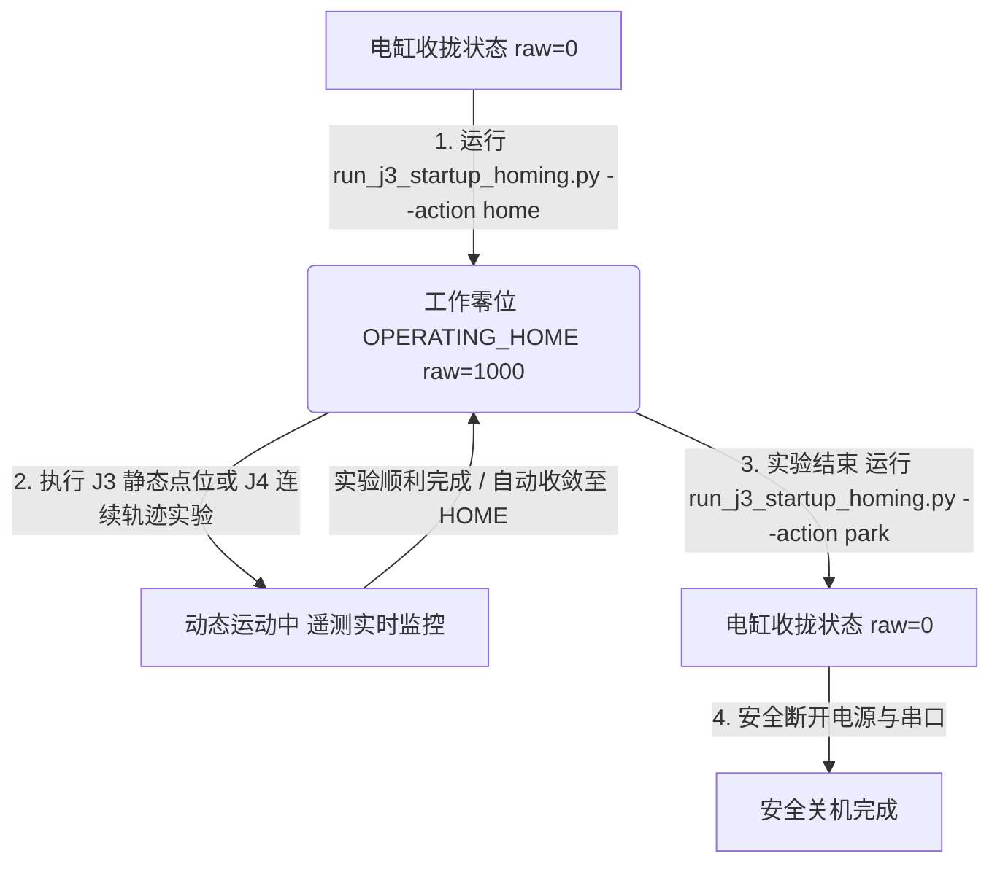

# 6PUS 并联机器人实机操作与命令速查指南 (Real Hardware Operation Guide)

> **权威性声明**：本文档为 **6PUS 并联骨科手术机器人平台唯一权威实机操作指南**（根目录唯一权威版本）。  
> 本文档基于已通过实机闭环验证的驱动代码、解析逆解、连续控制管线（J4 冻结版本）与安全参数编写，面向实验人员日常开机、运动控制、异常处理与关机操作。所有命令与参数均经源码实际解析核对。
>
> **当前物理边界优先于历史命令表**：完整 6PUS 机构尚未装配，两个 IMU 仍固定在同一块测试板。本文件前部保留 J3/J4 历史命令作为冻结接口速查；在当前状态下，不执行 HOME、J3 Cartesian 或 J4 实机轨迹。允许范围和命令前置条件以第 8、9 节为准。
>
> **装配前执行门禁（当前有效）**：第 0.1--0.3 节的 `--real-hardware` 命令是总装完成后的历史/冻结接口参考，当前不得复制执行。当前仅允许 source、路径/import、`--help`、Mock/dry-run、READ_ONLY 和 FK 只读 smoke；任何真实 HOME、PARK、J3 Cartesian 或 J4 轨迹都必须等待机构总装并取得单独授权。

---

### 0.0 新终端标准初始化（所有 ROS 2 / 实机命令先执行）

```bash
source /opt/ros/jazzy/setup.bash
source /home/lyapunov/bone_drill/bone_ws/install/setup.bash
cd /home/lyapunov/bone_drill
```

可选的环境自检（只读，不连接电机）：

```bash
ros2 pkg prefix pus6_msgs
python3 -c "import pus6_msgs, pus6_kinematics; print('ROS2_IMPORT_OK')"
```

直接执行 `bone_ws/scripts/run_j3_startup_homing.py` 时，脚本还会自行加入 `bone_ws/src/*` 到 `sys.path`，所以 J3 脚本当前不强制依赖 source；但 READ_ONLY、J4 和 FK/ROS 2 命令依赖已构建的 workspace，标准操作仍统一先执行上面的两行 `source`。

## 0. 常用命令速查表 (Direct Copy-Paste Cheat Sheet)

### 0.1 开关机与基准位姿管理 (J3 静态点到点)
| 操作目标 | 直接运行命令 (终端直接复制执行) | 硬件动作 | 运行前状态 | 结束状态 | 典型耗时 |
| :--- | :--- | :---: | :---: | :---: | :---: |
| **开机平滑就位 (Home)** | `python3 /home/lyapunov/bone_drill/bone_ws/scripts/run_j3_startup_homing.py --action home --speed 200 --real-hardware --confirm-motion --validated-config` | 协调顶升 | 停放位 `[0]*6` 或任意位置 | 工作零位 `[1000]*6` | ~11s |
| **实验结束安全收拢关机 (Park)** | `python3 /home/lyapunov/bone_drill/bone_ws/scripts/run_j3_startup_homing.py --action park --speed 200 --real-hardware --confirm-motion --validated-config` | 协调缩回最底 | `OPERATING_HOME` | 停放位 `[0]*6` (可断电) | ~11s |
| **中途任意位置平滑回零** | `python3 /home/lyapunov/bone_drill/bone_ws/scripts/run_j3_startup_homing.py --action home --speed 200 --real-hardware --confirm-motion --validated-config` | 协调回零 | 任意偏离位置 | `[1000]*6` | 3~11s |

### 0.2 J3 静态点到点单自由度/复合位姿验证 (返回 HOME)
| 操作目标 | 直接运行命令 (终端直接复制执行) | 运动特征 | 运行前状态 | 结束状态 | 典型耗时 |
| :--- | :--- | :---: | :---: | :---: | :---: |
| **垂直上升 +10mm** | `python3 /home/lyapunov/bone_drill/bone_ws/scripts/run_j3_cartesian_motion.py --test heave_pos --peak-speed 200 --real-hardware --confirm-motion --validated-config` | 垂直抬升并返回 | `OPERATING_HOME` | `[1000]*6` | ~11s |
| **垂直下降 -10mm** | `python3 /home/lyapunov/bone_drill/bone_ws/scripts/run_j3_cartesian_motion.py --test heave_neg --peak-speed 200 --real-hardware --confirm-motion --validated-config` | 垂直下降并返回 | `OPERATING_HOME` | `[1000]*6` | ~11s |
| **前后平移 X ±5mm** | `python3 /home/lyapunov/bone_drill/bone_ws/scripts/run_j3_cartesian_motion.py --test surge_pos --peak-speed 200 --real-hardware --confirm-motion --validated-config` | 前移并返回 | `OPERATING_HOME` | `[1000]*6` | ~6s |
| **左右平移 Y ±5mm** | `python3 /home/lyapunov/bone_drill/bone_ws/scripts/run_j3_cartesian_motion.py --test sway_pos --peak-speed 200 --real-hardware --confirm-motion --validated-config` | 左移并返回 | `OPERATING_HOME` | `[1000]*6` | ~6s |
| **俯仰抬头 Pitch +2.86°** | `python3 /home/lyapunov/bone_drill/bone_ws/scripts/run_j3_cartesian_motion.py --test pitch_pos --peak-speed 200 --real-hardware --confirm-motion --validated-config` | 前抬后压并返回 | `OPERATING_HOME` | `[1000]*6` | ~6s |
| **横滚倾斜 Roll +2.86°** | `python3 /home/lyapunov/bone_drill/bone_ws/scripts/run_j3_cartesian_motion.py --test roll_pos --peak-speed 200 --real-hardware --confirm-motion --validated-config` | 右倾并返回 | `OPERATING_HOME` | `[1000]*6` | ~6s |
| **偏航扭转 Yaw +2.86°** | `python3 /home/lyapunov/bone_drill/bone_ws/scripts/run_j3_cartesian_motion.py --test yaw_pos --peak-speed 200 --real-hardware --confirm-motion --validated-config` | 水平顺扭并返回 | `OPERATING_HOME` | `[1000]*6` | ~5s |
| **6DoF 空间复合点位 (M13)** | `python3 /home/lyapunov/bone_drill/bone_ws/scripts/run_j3_cartesian_motion.py --test combined_6dof --peak-speed 200 --real-hardware --confirm-motion --validated-config` | 全自由度联动并返回 | `OPERATING_HOME` | `[1000]*6` | ~9s |

### 0.3 J4 连续笛卡尔动态轨迹控制 (J4 冻结正式链路)
> **说明**：所有 J4 动态实验均自动包含 F1B-0（10 周期静态预热）与起止平滑过渡。运行前机构必须已处于 `OPERATING_HOME`。

| 实验代号 | 运动模式参数 (`--motion`) | 轨迹数学定义与幅值 | 持续时间 | 直接运行命令 (终端直接复制执行) |
| :--- | :--- | :--- | :---: | :--- |
| **J4-F1B-1** | `heave` | $Z = z_0 \pm 2.0\text{ mm} @ 0.2\text{ Hz}$ | 5.0 s | `python3 /home/lyapunov/bone_drill/bone_ws/scripts/run_j4_f1b_real_cartesian_motion.py --motion heave --duration 5.0 --real-hardware --confirm-motion --validated-config` |
| **J4-F1B-2** | `pitch` | $\text{Pitch} = \pm 0.020\text{ rad} @ 0.2\text{ Hz}$ | 5.0 s | `python3 /home/lyapunov/bone_drill/bone_ws/scripts/run_j4_f1b_real_cartesian_motion.py --motion pitch --duration 5.0 --real-hardware --confirm-motion --validated-config` |
| **J4-F1C** | `f1c` 或 `heave_pitch` | $Z \pm 1.5\text{ mm} + \text{Pitch} \pm 0.015\text{ rad}$ | 15.0 s | `python3 /home/lyapunov/bone_drill/bone_ws/scripts/run_j4_f1b_real_cartesian_motion.py --motion f1c --duration 15.0 --real-hardware --confirm-motion --validated-config` |
| **J4-F1D** | `f1d` 或 `3dof` | $X \pm 2.0\text{ mm}, Z \pm 1.5\text{ mm}, \text{Pitch} \pm 0.015\text{ rad}$ (非同相) | 18.0 s | `python3 /home/lyapunov/bone_drill/bone_ws/scripts/run_j4_f1b_real_cartesian_motion.py --motion f1d --duration 18.0 --real-hardware --confirm-motion --validated-config` |
| **J4-F1E** | `f1e` 或 `6dof` | **全 6 自由度非同相复合连续空间轨迹** ($X,Y \pm 1.5\text{mm}, Z \pm 1.0\text{mm}, R,P \pm 0.01\text{rad}, Y \pm 0.008\text{rad}$) | 18.0 s | `python3 /home/lyapunov/bone_drill/bone_ws/scripts/run_j4_f1b_real_cartesian_motion.py --motion f1e --duration 18.0 --real-hardware --confirm-motion --validated-config` |

---

## 1. 核心坐标、物理基准与单位换算

### 1.1 两个核心物理基准
```
+-----------------------------------------------------------------------------------------+
| 1. STORAGE_PARK (机械停放位 / 关机收拢位)                                                 |
|    - 原始步数: raw ≈ [0, 0, 0, 0, 0, 0] step                                           |
|    - 物理状态: 6 根推杆全部缩回至最短位置，仅用于收拢/停放                             |
|    - 定位: 仅用于受控关机收拢、搬运防磕碰与断电停放。严禁在此处直接执行姿态控制！            |
+-----------------------------------------------------------------------------------------+
                                      ▲
                                      │ 一键顶升 (action home) / 一键收拢 (action park)
                                      ▼
+-----------------------------------------------------------------------------------------+
| 2. OPERATING_HOME (工作零位 / 软件控制基准)                                             |
|    - 原始步数: raw ≈ [1000, 1000, 1000, 1000, 1000, 1000] step                            |
|    - 物理推杆: 约 50.0 mm 伸出（以实测机构零位为准）                                   |
|    - 动平台绝对高度: z_nom ≈ 0.1326123 m (132.6123 mm)                                   |
|    - 软件相对坐标: q_relative = q_raw - 1000 = [0, 0, 0, 0, 0, 0]                       |
|    - 定位: 6PUS 机构所有笛卡尔逆解 (IK)、平移、旋转与连续控制算法的基准原点！               |
+-----------------------------------------------------------------------------------------+
```

### 1.2 单位与换算关系
* **步距比例**：$1\text{ mm} = 40\text{ step}$ ($1\text{ step} = 0.025\text{ mm}$)；
* **关节相对坐标**：$q_{\text{relative}} = q_{\text{raw}} - 1000\text{ step}$；
* **标称运行速度**：规划限速 $200\text{ step/s} = 5.0\text{ mm/s}$（电缸 0x28 限速寄存器自适应配置为 $240\text{ step/s} = 6.0\text{ mm/s}$）；
* **笛卡尔姿态定义**：动平台位姿使用 $[x, y, z, \text{roll}, \text{pitch}, \text{yaw}]$ 描述，其中 $z$ 为绝对高度（标称值 $z_0 = 0.132612\text{ m}$），旋转采用 ZYX 欧拉角约定。

### 1.3 安全工作空间与软件包络 (Temporary J4 Envelope)
所有运动均由驱动与运动学节点强制限制在以下安全包络内：
* **关节物理步数范围**：$[200, 1800]\text{ step}$（对应行程 $5.0 \sim 45.0\text{ mm}$，距极限两端留有 $5.0\text{ mm}$ 缓冲）；
* **笛卡尔平移**：$X, Y \in [-15.0, +15.0]\text{ mm}$，$Z - z_0 \in [-20.0, +20.0]\text{ mm}$；
* **笛卡尔旋转**：$\text{Roll}, \text{Pitch}, \text{Yaw} \in [-0.10, +0.10]\text{ rad}$ ($\pm 5.73^\circ$)；
* **电机单步硬门禁**：驱动层单次下发物理增量严格限制为 $|\Delta q_i| \le \mathbf{20\text{ steps}}$ ($0.5\text{ mm}$)。

---

## 2. J4 控制管线与核心保护机制对实验人员的含义

### 2.1 频率与 Latest-Value-Wins 单槽缓冲
* **标称与实际频率**：
  - 规划层 50 Hz nominal 参考流（F1E 实测平均 $49.33\text{ Hz}$）持续发布目标；
  - 驱动层 25 Hz nominal 串口线程（F1E 实测平均 $23.61\text{ Hz}$）消费最新目标；
* **对实验人员的含义**：Latest-Value-Wins 的覆盖比例由生产/消费实际速率决定（F1E 实测覆盖率约为 $52.0\%$ 即 $462/888$）。这属于**设计的动态正常现象**，确保驱动层永远只执行最新指令，绝不会产生指令堆积或历史延迟积压。

### 2.2 Time-Aware Vector Slew Recovery（时间自适应矢量斜率恢复）
* **机理**：当发生 UART request-response timing jitter / timeout / ROS2 调度长尾时，目标流会累积 $20\sim 50\text{ 步}$ 的位移跨度；
* **对实验人员的含义**：驱动层**不会触发前检死锁**，也不会单轴强行截断造成平台扭曲。它会自动根据流逝时间计算安全裕量，将六轴修正矢量同比例缩放（单步物理增量严格 $\le 20\text{ steps}$），并在 $2\sim 3$ 个周期内平滑追上最新目标流，平台动作平顺无冲击。

### 2.3 Delivery-Uncertain Resync（异常重锚与条件恢复状态机）
* **机理**：当发生 UART 读超时（50ms 未收到回包）时，下位机可能已经执行了命令但上位机未确认；
* **恢复触发条件**：驱动层自动执行 `pause_all()` $\to$ 重新读取六轴真实物理位置快照 $\to$ **严格校验快照非 stale、所有 fault_codes == 0 且位置处于 [200, 1800] 合法包络内** $\to$ 以实测物理位置重构恢复基准 $\to$ 经矢量斜率恢复重归 NORMAL。若校验失败，系统将直接触发 Safety Halt 拒绝 rearm。

### 2.4 数据采集与度量边界
* **度量范围**：所有日志记录的跟随误差与频域特性（如 MAE、幅值保真度、相位滞后）仅评估**下发指令 $q_{\text{cmd}}$ 与电缸编码器测量 $q_{\text{actual}}$ 之间的关节空间动态跟随性能**；
* **不宣称真实末端精度**：未接入外部光学跟踪仪前，系统不宣称动平台在真实物理空间中的绝对末端跟踪精度。

---

## 3. 标准实验全流程操作规范



### 步骤 1：开机与零位就位 (Startup / Home)
```bash
python3 /home/lyapunov/bone_drill/bone_ws/scripts/run_j3_startup_homing.py \
    --action home \
    --speed 200 \
    --real-hardware \
    --confirm-motion \
    --validated-config
```
* 终端显示 `[PASS] Successfully homed all motors to [1000, 1000, 1000, 1000, 1000, 1000]`，六轴就位完成。

### 步骤 2：执行连续笛卡尔实验 (以 Full 6DoF 为例)
```bash
python3 /home/lyapunov/bone_drill/bone_ws/scripts/run_j4_f1b_real_cartesian_motion.py \
    --motion f1e \
    --duration 18.0 \
    --real-hardware \
    --confirm-motion \
    --validated-config
```
* 运动将自动经历：
  1. 10 周期静态预热；
  2. 1.0s 五次多项式平滑注入；
  3. 15.0s 满幅 3 周期 6DoF 空间连续运动；
  4. 1.0s 平滑退出；
  5. 1.0s HOME 沉降静止（六轴编码器收敛至 OPERATING_HOME 邻域，残差 $0\sim 2\text{ steps}$）。

### 步骤 3：关机与收拢停放 (Park / Shutdown)
```bash
python3 /home/lyapunov/bone_drill/bone_ws/scripts/run_j3_startup_homing.py \
    --action park \
    --speed 200 \
    --real-hardware \
    --confirm-motion \
    --validated-config
```
* 机构平稳缩回至最底停放位 `raw [0,0,0,0,0,0]`，此时可安全关闭 24V 主电源与拔出 USB 转串口线。

---

## 4. 故障排查、急停与日志分析

### 4.1 应急停止流程 (Emergency Stop)
若在实验过程中发现机械干涉、异常异响或需要中途紧急中止：
1. **键盘中断**：直接在运行终端按下 `Ctrl + C`，驱动节点与 runner 会捕获信号并下发最佳努力的 `pause_all` 指令；
2. **硬件断电**：按下 24V 动力电源总开关或拔掉电缸动力插头。

### 4.2 异常状态恢复 (Recovery)
若机构意外断电、卡滞或处于非零位未知状态：
1. 检查各轴机械结构是否卡住；
2. 重新上电后，直接运行 `run_j3_startup_homing.py --action home`，算法会自动读取各轴当前实际位置，计算最大行程差，并以平滑 S 曲线协调顶升至 `OPERATING_HOME`。

### 4.3 实验日志位置与查看
每次实机运行的完整高频遥测（含目标、实际位置、电流、力、时延与事件流）均自动保存在：
```bash
/home/lyapunov/bone_drill/bone_ws/log/
```
查看最新一次 Full 6DoF 实验总结：
```bash
ls -lt /home/lyapunov/bone_drill/bone_ws/log/j4_f1e_real_cartesian_6dof_*.json | head -n 1
```

---

## 5. J5 阶段多源遥测、时间轴合同与工程操作规范 (J5 Multi-Source Telemetry & Time Contract)

### 5.1 当前物理装配状态与操作边界红线 (Current Physical State & Safety Boundaries)
> [!IMPORTANT]
> **当前物理状态**：
> 1. 6PUS 并联机构本体尚未完成总装（动平台与球铰杆件未就位）；
> 2. 两个 H30 IMU 目前仍刚性固连在同一块测试基板上。

* **当前允许的操作**：
  * Mock/dry-run、导入检查、READ_ONLY UART 审计和纯软件 Fixed-Lag/FK/topic 链路验证；
  * 两个 IMU 同板的同步、相对姿态和零偏观测，但只能作为共刚体测试；
  * 经单独书面授权、现场确认后的 PARK/基础 UART 命令链路检查。PARK 即使目标已是 raw `0`，ACTIVE 初始化和停机仍可能写配置或 pause，因此不是只读操作。
* **当前严禁执行的操作（必须等待机构总装完成后方可开展）**：
  * 严禁执行 HOME、J3 Cartesian 和任何 J4 实机运动；
  * 严禁进行真实机械平台的大行程空间 6DoF 姿态运动；
  * 严禁将两块 IMU 的相对姿态与正运动学解算位姿进行实机对比；
  * 严禁宣称实机正运动学几何定位精度已实测达标；
  * 严禁提前启动 ESKF 滤波闭环或 Dual-IMU/FK 融合控制。

### 5.2 统一时钟合同与 Timed Telemetry 观测语义
为消除多传感器与总线异步采集的时钟混淆，系统确立了严格的时间合同：
1. **统一时钟源**：所有底层时间戳一律使用主机 `CLOCK_MONOTONIC`（纳秒 `ns`），严禁使用系统墙上时钟（Wall-clock）；
2. **`TimedJointFeedback` (`/pus6/joint_feedback/timed`)**：
   * `per_axis_rx_done_monotonic_ns[6]`：Host 侧接收完成每个电机 0x29 应答的单调时间戳（**不是电机内部物理采样的瞬间时刻**）；
   * `snapshot_start_monotonic_ns` / `snapshot_end_monotonic_ns`：整组 6 轴扫描的发起与结束时间；
   * `header.stamp`：严格定义为 ROS 2 消息的发布时刻 (`node.get_clock().now()`)。
3. **`TimedJointCommand` (`/pus6/joint_command/timed`)**：
   * `per_axis_tx_start/done_monotonic_ns[6]`：Host 发送 0x29 控制帧的单调时刻。
4. **`uart_cycle_sequence` 序列语义**：
   * 在主动写控制周期下，Command 与 Feedback 严格具备 1-to-1 相同序号对应；
   * 在静止/故障恢复/纯读状态下，允许存在合法的 Feedback-only 帧。

### 5.3 UART 批次原子性与底层并发加固 (Batch Atomicity Hotfix)
* **历史隐患**：原系统在 Active 模式下存在 Worker 线程发送 0x29 写指令与 DriverNode 定时器发送 0x29 读指令相互穿插交错的风险，导致 6 轴扫描时跨严重拉长；
* **加固措施**：在 `six_motor_controller.py` 中引入完整的 6 轴批次全局互斥锁（`with self._bus_lock_ctx:`），并在 Active 控制模式下彻底抑制独立的 Poll 轮询；
* **回归指标**：实机连续回归实证 Batch Overlap = $0\ /\ 392$ ($100.00\%$ 原子性无交错)。

### 5.4 Fixed-Lag 状态同步重建与零外推操作准则
因为 6 个电机挂载在单条半双工 UART 总线上（逐轴串行通信间隔约 4ms，整批跨度约 24~30ms），6 轴反馈存在时间相位差。
* **滑动历史对齐原理**：由 `FixedLagJointSynchronizer` 维护各轴滑动历史队列；
* **严格双向夹逼门禁**：在查询时刻 $t_{\text{query}}$，仅当六轴**全部**满足 $t_i^{(k-1)} \le t_{\text{query}} \le t_i^{(k)}$ 时才进行线性插值重建；
* **严格 0 外推**：任一轴未被 Bracketed 或遭遇长尾丢帧时，状态机立即返回 `WAIT_FUTURE_SAMPLE` 或 `WAIT_TOO_EARLY` 并拒绝发布，**绝不允许任何外推伪位姿泄露**。

---

## 6. 历史性能快照（2026-08-19，已被后续阶段修正）

> 本节保留 J5-C2-RT-SW-C 消融前的原始问题记录，用于解释 451 callbacks 的来源；不代表当前阶段状态，也不应作为运行方式或验收结论。当前结论见第 7 节。

* **今日开发状态总结**：
  * **J5-C1 (统一时间轴、Timed Telemetry 接口与 Batch 原子性)**：$\mathbf{PASS\ /\ FROZEN}$；
  * **J5-C2-SW (6PUS 正运动学数学实现与 IK↔FK 一致性验证)**：$\mathbf{PASS\ /\ FROZEN}$；
  * **J5-C2-RT-SW (Fixed-Lag q_sync 与 Real-Time FK 实时软件链)**：$\mathbf{INCOMPLETE}$。
* **未决技术问题**：
  10 秒标称 200Hz ROS 2 定时器在多线程执行器下实际仅触发约 451 次回调（实际均值约 45Hz），尽管中位数 P50 ≈ 5.02ms，但存在严重的调度长尾（P95 = 81.28ms, P99 = 379.48ms, Max = 894.74ms）。
* **明天下一步任务 (Next Step)**：
  启动 **J5-C2-RT-SW-C**，对 ROS 2 200Hz 定时器进行 A~F 六层分层性能消融（纯定时器 $\to$ 加发布者 $\to$ 加同步器 $\to$ 加 FK 解算 $\to$ 加 ROS 发布 $\to$ 异常注入），精确定位 Python rclpy 执行器、GIL 竞争、CallbackGroup 互斥与锁竞争瓶颈，并制定后续架构优化方案。

---

## 7. J5-C2 软件最终冻结与装配前操作边界（2026-08-20）

本节是对前文历史快照的最终收尾，后续操作以本节和 `agent_docs/J5_C2_FINAL_SUMMARY.md` 为准。

### 7.1 当前 J5 工程状态

* **J5-A = PASS / FROZEN**；**J5-B1 = PASS / FROZEN**；**J5-B2 = DEFERRED**（等待最终安装外参与 lever arm 条件）；**J5-B3 = PASS / FROZEN**（当前为同板共刚体验证）；**J5-B4 = PENDING**。
* **J5-C1 = PASS / FROZEN**：Timed telemetry、Host `CLOCK_MONOTONIC` 时间合同、UART batch-atomicity hotfix 和 Fixed-Lag 接口已冻结。
* **J5-C2-SW = PASS / FROZEN**：真实几何 FK、解析 ZYX Jacobian + LM、IK→FK round-trip、Warm Start/assembly branch 连续性和跳变门禁已冻结。
* **J5-C2-RT-SW = PASS / FROZEN**：FK 节点必须使用独立 `SingleThreadedExecutor`。最终软件验收是 `2007 callbacks/10s`、`200.09 Hz`、period P95 约 `5.14 ms`，本轮全量 pytest 为 `162 passed`；baseline 中的 `468 passed` 是 P0 收敛时的历史统计，需按其当时的收集范围理解。
* 旧章节中关于“451 callbacks、J5-C2-RT-SW INCOMPLETE”的文字是消融前历史记录；其根因已定位为 `MultiThreadedExecutor(4)` 下的严重 callback starvation，不是新的验收结论。

### 7.2 Timed telemetry、monotonic 时间与 Fixed-Lag

`/pus6/joint_feedback/timed` 的 `TimedJointFeedback` 使用 Host `CLOCK_MONOTONIC` 纳秒时间戳。`per_axis_rx_done_monotonic_ns[6]` 表示各轴 0x29 应答在主机侧接收完成的时刻；`header.stamp` 仅表示 ROS 消息发布时间，不能替代算法时间。

`FixedLagJointSynchronizer` 对六个轴分别维护滑动历史。查询时刻为“当前 monotonic 时刻 - 固定延迟”，只有六轴都在历史样本的前后 bracket 内才线性插值生成 `q_sync`。任一轴没有未来样本、查询过早或数据不连续时都等待/丢弃，严格 **0 extrapolation**，不得用趋势外推伪造平台位姿。

### 7.3 UART batch-atomicity hotfix

J4 已冻结的控制行为和安全策略不得改变。UART transport 现已使用六轴 batch 全局锁，并在 Active 模式抑制独立 poll，避免写周期和读周期互相穿插。实证 Batch Overlap 为 `0 / 392`。本节只记录该冻结约束，不要求也不允许在本阶段再次修改底层 hotfix。

### 7.4 FK 节点的运行方式与独立执行器约束

纯软件或 mock 遥测验证时，在已经 source ROS 2 和 workspace 后可运行：

```bash
source /opt/ros/jazzy/setup.bash
source /home/lyapunov/bone_drill/bone_ws/install/setup.bash
ros2 run pus6_kinematics fk_node
```

`pus6_kinematics/fk_node.py` 的 `main()` 内部创建独立 `SingleThreadedExecutor`，订阅 `/pus6/joint_feedback/timed`，发布 `/pus6/fk/state` 和 `/pus6/fk/pose`。不要把该节点并入包含高频 publisher、subscriber 或硬件驱动的 `MultiThreadedExecutor`。

原因已由 A-F 消融确认：空 timer 和简单 publisher 在多线程下仍接近 200 Hz，但加入 Fixed-Lag/FK 后 ready callback 出现严重 starvation，10 秒仅约 451 次、P95/P99 出现百毫秒至近秒停顿。Python GIL 和 rclpy 多线程调度争用会放大这一现象；单次 NumPy、RLock 或 publish 耗时并非 451 次现象的主因。独立单线程执行器是当前冻结的实时架构约束，不是可选的测试参数。

### 7.5 HOME/PARK 基础运维与 J5 ROS 节点解耦

HOME、PARK、急停和基础 UART 诊断属于 J3/J4 基础运维，不应依赖 `pus6_kinematics` 的 FK ROS 节点，也不应因为未 source `pus6_msgs` 而失效。执行这些操作时使用已有的 `run_j3_startup_homing.py` 和冻结的驱动/安全策略；FK 节点只消费 Timed telemetry 做观测，不发送运动命令。

### 7.6 当前允许与必须等待的实机操作

当前可执行（默认不得产生硬件写入；实机写操作必须有单独书面授权）：

* Mock/dry-run 的 J3 HOME/PARK、导入/帮助检查和安全回归；
* J2-A READ_ONLY UART 审计，必须保持 `hardware_write_count = 0` 且 `fault = 0`；
* FK 只读节点、Fixed-Lag/FK/topic 软件链路和离线 C2-HW synthetic/replay；
* 两个 IMU 同板的同步、相对姿态和零偏观测；

必须等完整机构装配和几何复核后：

* 真实 HOME、PARK、J3 Cartesian 和任何 J4 实机轨迹（包括小幅轨迹）；
* 真实机械平台的大行程 6DoF 姿态运动和最终机械 FK 精度宣称；
* `q_actual → Fixed-Lag → FK → 实际 T_BP` 的实机验证；
* 两个 IMU 的最终安装外参、lever arm、Dual-IMU/FK 融合和 ESKF；
* 任何 C3 工作。当前两个 IMU 固定在同一块测试板，不能作为最终空间外参验证。

### 7.7 机构装配完成后的下一阶段清单（只做准备）

1. 核对最终机械几何、杆长、安装角、软件零位和 `OPERATING_HOME`；确认 `STORAGE_PARK` 仅用于收拢停放。
2. 完成 J5-B2 最终双 IMU 外参与 lever arm 标定，确认坐标系和旋转约定。
3. 启动 J5-C2-HW，采集真实 `q_actual`，按 `TimedJointFeedback → Fixed-Lag → q_sync → FK` 验证实际 `T_BP`。
4. 只有第 3 项通过后，才进入平动模型和 Dual-IMU/FK 融合；ESKF/C3 不提前实现。

---

## 8. HOME / PARK / READ_ONLY 命令审计与新终端流程（2026-08-20）

### 8.1 昨晚 PARK 失败的最终根因

旧错误 `ModuleNotFoundError: No module named 'pus6_msgs'` 发生在 J3 脚本导入 `pus6_kinematics` 时：旧版 `pus6_kinematics/__init__.py` eager import 了 ROS FK 节点，未 source workspace 时因此强制加载生成消息包。当前 `__init__.py` 已改为只在显式请求 `Pus6FkNode` 时惰性导入 `fk_node`；`run_j3_startup_homing.py` 也会自行加入 `bone_ws/src/*`，所以该回归已修复。PARK 的目标选择和运动逻辑不是失败原因。

### 8.2 入口、参数和硬件动作语义

权威 J3 入口只有：

```text
/home/lyapunov/bone_drill/bone_ws/scripts/run_j3_startup_homing.py
```

它支持 `--action {home,park}`、`--speed`、`--control-rate`、`--real-hardware`、`--confirm-motion`、`--validated-config` 和 `--port`。串口优先级为 **CLI `--port` override > 共享 `DEFAULT_SERIAL_PORT` validated 默认**；该默认与 `pus6_motor_driver/config/motors.yaml` 中的 by-id 配置保持一致，当前值为 `/dev/serial/by-id/usb-1a86_USB_Serial-if00-port0`。脚本仅在三个实机开关同时存在时进入 `HardwareMode.ACTIVE`；否则为 `MOCK`，不会连接真实串口。

目标语义固定为：

* `--action home`：`OPERATING_HOME`，raw 目标约 `[1000,1000,1000,1000,1000,1000]`，约 50 mm 伸出；会产生实机运动；
* `--action park`：`STORAGE_PARK`，raw 目标约 `[0,0,0,0,0,0]`，最短位置；会产生实机运动（若已在目标，脚本会跳过轨迹，但 ACTIVE 初始化/停机仍可能产生配置或 pause 写入）；
* 不带 `--real-hardware` 的 HOME/PARK：仅 Mock/dry-run，日志必须显示 `Hardware Mode: mock`；
* `ros2 run pus6_kinematics fk_node`：只读 FK 观测，不发送电机命令，但必须 source ROS2 和 workspace。

### 8.3 新终端 → import/help → Mock → READ_ONLY

每个新终端先复制：

```bash
source /opt/ros/jazzy/setup.bash
source /home/lyapunov/bone_drill/bone_ws/install/setup.bash
cd /home/lyapunov/bone_drill
```

然后按以下顺序执行：

```bash
# 1) 导入检查，不连接硬件
python3 -c "import pus6_msgs, pus6_kinematics; print('ROS2_IMPORT_OK')"

# 2) J3 参数检查，不连接硬件
python3 /home/lyapunov/bone_drill/bone_ws/scripts/run_j3_startup_homing.py --help

# 3) Mock/dry-run；不要添加 --real-hardware
python3 /home/lyapunov/bone_drill/bone_ws/scripts/run_j3_startup_homing.py \
    --action park --speed 200
```

READ_ONLY 审计脚本是函数式入口，没有 argparse `--help`；不要直接给它传 `--help`，应使用：

```bash
cd /home/lyapunov/bone_drill/bone_ws/scripts
python3 -c "from run_j2a_readonly_verification import run_j2a_verification; raise SystemExit(run_j2a_verification(duration_sec=60.0, port='/dev/serial/by-id/usb-1a86_USB_Serial-if00-port0', baudrate=921600))"
```

该流程强制 `hardware_mode=read_only`，并在 startup、runtime、shutdown 检查 `total hardware writes = 0`。它只读取 `/dev/serial/by-id/usb-1a86_USB_Serial-if00-port0` 的六轴遥测，不发送运动、配置或 pause 写命令。若 by-id 链接不存在，停止并先核对 UART，不要改成猜测性的串口节点。

### 8.4 实机 PARK / HOME 的标准流程（总装后授权流程；当前禁止）

以下命令会产生实机写入或运动，只能在完整机构装配、机械几何/零位复核、READ_ONLY 与 Mock 均通过，并取得单独书面授权后执行。**当前未装配状态禁止执行，即使目标已经是 raw `[0]*6`。**

授权后先核对 validated by-id 串口：

```bash
readlink -f /dev/serial/by-id/usb-1a86_USB_Serial-if00-port0
test -e /dev/serial/by-id/usb-1a86_USB_Serial-if00-port0
```

上述检查失败就停止。当前核对结果为 by-id 链接存在并指向 `/dev/ttyUSB0`。只有在明确核对了替代设备后，才使用 `--port /dev/具体设备` override。

PARK（会产生实机写入；用于安全收拢）：

```bash
python3 /home/lyapunov/bone_drill/bone_ws/scripts/run_j3_startup_homing.py \
    --action park --speed 200 --real-hardware --confirm-motion --validated-config
```

HOME（会产生实机写入并顶升至约 50 mm 伸出；当前完整机构未装配时禁止执行）：

```bash
python3 /home/lyapunov/bone_drill/bone_ws/scripts/run_j3_startup_homing.py \
    --action home --speed 200 --real-hardware --confirm-motion --validated-config
```

执行结束必须核对日志中的 `Final Raw Steps`、`Final Position Errors`、`Safety Invariants Kept`。当前不执行上述命令；本轮只做 Mock 和 READ_ONLY。不要以 HOME、PARK、J4 轨迹或 FK 数值结果替代真实机械装配验证。

### 8.5 J4 与 FK 启动边界

所有 J4 `run_j4_f1b_real_cartesian_motion.py` 和 J3 Cartesian 命令只在机构完整装配、已处于 `OPERATING_HOME` 且获得单独实机运动授权后运行；命令中的 `--real-hardware --confirm-motion --validated-config` 明确表示会运动。当前不要执行这些命令。

FK 观测节点的标准启动为：

```bash
source /opt/ros/jazzy/setup.bash
source /home/lyapunov/bone_drill/bone_ws/install/setup.bash
ros2 run pus6_kinematics fk_node
```

它订阅 `/pus6/joint_feedback/timed`，发布 `/pus6/fk/state` 和 `/pus6/fk/pose`，内部使用独立 `SingleThreadedExecutor`，不依赖 HOME/PARK，也不发送电机运动命令。

## 9. 当前操作判定、常见排查与阅读建议

### 9.1 当前操作判定

| 命令或操作 | 当前是否允许 | 是否产生电机写入 / 运动 |
|---|---|---|
| import、`--help`、Mock/dry-run | 允许 | 否 |
| J2-A READ_ONLY | 允许 | 否；必须核对日志 `total hardware writes = 0` |
| `ros2 run pus6_kinematics fk_node` | 允许，仅观测 | 否 |
| PARK | 当前禁止；总装后仅 maintenance 授权流程 | 是；目标为 raw `[0]*6` |
| HOME、J3 Cartesian、J4 实机轨迹 | 当前禁止 | 是；等待完整机构装配 |
| J5-C2-HW、最终外参、lever arm、融合/ESKF | 当前禁止 | 不得启动 |

### 9.2 常见现象与排查边界

* `ModuleNotFoundError: pus6_msgs`：新终端先执行第 0.0 节两行 `source`。J3 独立脚本的 eager-import 回归已经修复；若仍出现该错误，先确认启动的是当前工作区的脚本而不是旧副本。
* by-id 串口不存在：停止，不要把 `/dev/ttyUSB0` 当作默认路径猜测使用。检查 `/dev/serial/by-id/usb-1a86_USB_Serial-if00-port0` 和接线；只有明确核对替代设备后才用 `--port`。
* READ_ONLY 日志出现任何 write：立即停止并作为安全失败处理；正确 READ_ONLY 结果为 startup、runtime、shutdown 和 total 均为 0。
* FK 节点没有发布：先区分“无 timed feedback”与 Fixed-Lag 的 `WAIT/DROP`。50 ms 是配置延迟，不保证每一帧必然获得六轴 bracket；任一轴未 bracket 时拒绝发布是正确行为。
* 200 Hz 性能异常：不要把 J4 的 `MultiThreadedExecutor` 经验套到 FK。FK 节点必须保持独立 `SingleThreadedExecutor`；若出现真正的 safety STOP、fault 或机械异常，按第 4.1 节急停，而不是将其解释为单纯 ROS 调度现象。

### 9.3 `maintenance_mode` 语义

`maintenance_mode` 只适用于 ROS `pus6_control`/`pus6_motor_driver` 的受控维护路径：默认 `false` 时，普通运行包络为 `[200,1800]`，raw `[0]*6` PARK 被拒绝；显式 `maintenance_mode=true` 后，且其他反馈新鲜度、fault、批次原子性和步进门禁均通过，才允许受控 PARK 进入绝对范围 `[0,2000]`。它不改变 J4 算法、安全策略或 UART 协议，也不把普通运动包络扩大为可运行空间。独立 `run_j3_startup_homing.py` 不通过该参数绕过门禁，真实运行仍需 `--real-hardware --confirm-motion --validated-config`；当前未装配时两条路径都禁止真实运动。

### 9.4 当前阅读建议

需要连接、诊断或执行任何实机相关命令时先读本手册第 0.0、5.1、8、9 节，再回看历史命令表。当前学习和操作停止在“软件冻结、等待机构装配”：机构总装、几何/零位复核完成后，从第 7.7 节的 J5-C2-HW 清单继续；在此之前不以 HOME、J4 或数值 FK 结果宣称真实机械精度。

### 9.5 C2-HW 离线验收工具

装配前只运行 Mock/synthetic/replay 验收脚本：

```bash
python3 /home/lyapunov/bone_drill/bone_ws/scripts/run_j5_c2_hw_acceptance.py \
  --duration-s 10 --feedback-hz 30 --query-rate-hz 200 \
  --output-prefix /tmp/j5_c2_hw_acceptance
```

该脚本只消费 `TimedJointFeedback` 形状的数据，输出 JSON/CSV，不打开串口、不启动 ROS executor、不产生运动。装配后门禁顺序和报告字段见 `agent_docs/J5_C2_HW_ACCEPTANCE_TOOLCHAIN.md`；报告中的软件 `FK_OK` 不能替代真实机构验收。

### 9.6 本轮冷启动执行验收记录（2026-08-20）

以下结果来自无预置 shell 环境（`bash --noprofile --norc`），严格按本手册顺序执行；本轮没有真实 HOME、PARK 或 J4 轨迹。

| 步骤 | 结果 | 关键证据 |
|---|---|---|
| source `/opt/ros/jazzy`、workspace、`cd` | PASS | `ROS_DISTRO=jazzy`；`ros2 pkg prefix pus6_msgs/pus6_kinematics` 指向当前 workspace |
| import 与 geometry | PASS | `IMPORT_OK`；`STORAGE_PARK=(0,0,0,0,0,0)`、`OPERATING_HOME=(1000,)*6`、`steps_per_meter=40000.0` |
| by-id 检查 | PASS | 链接存在；当前解析目标为 `/dev/ttyUSB0`，命令仍只使用 by-id 路径 |
| J3/C2-HW `--help` | PASS | 参数解析成功；J3 默认端口为 validated by-id |
| Mock HOME | PASS | `Hardware Mode: mock`；最终 raw `[1000]*6`；误差全 0；Safety Invariants `PASS` |
| Mock PARK | PASS | `Hardware Mode: mock`；最终 raw `[0]*6`；误差全 0；Safety Invariants `PASS` |
| C2-HW synthetic smoke | PASS | 60 frames、351 `FK_OK`、0 fault、0 sequence gap/duplicate/out-of-order；JSON/CSV 已生成 |
| maintenance preflight Mock | PASS | `maintenance_mode=false` 拒绝 raw `[0]*6`；`true` 接受；两次 `write_count=0` |
| J2-A READ_ONLY 60 s | PASS | 600 cycles；初始/最终 raw `[0]*6`；fault 全 0；startup/runtime/shutdown/total writes 均 0 |
| FK read-only smoke | PASS | 节点初始化 `query_rate=200 Hz`；SIGINT 超时退出码 124 为预期；无 `rclpy` traceback |

READ_ONLY 日志：`bone_ws/log/j2a_readonly_20260820_142248.json` / `.log`。本轮实机只读最终状态为 `raw=[0,0,0,0,0,0]`、`fault=0`、`hardware_write_count=0`。
