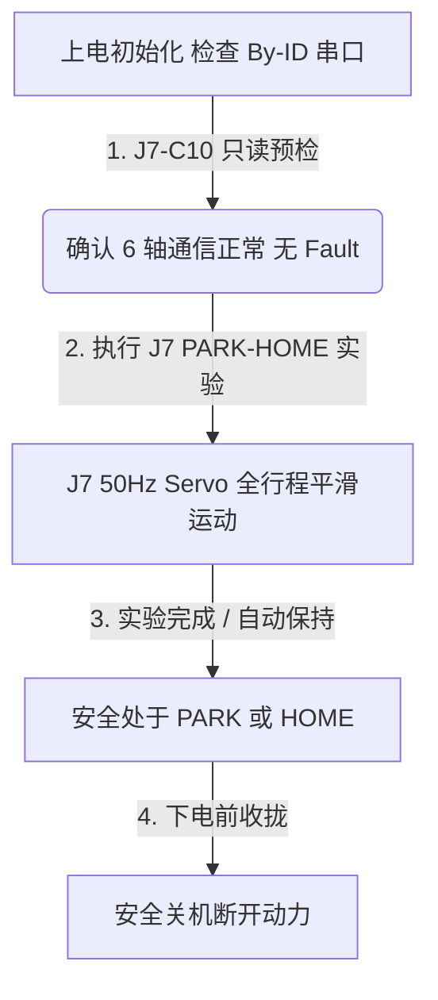

> [!WARNING]
> **文档状态：Historical / Legacy / Superseded（已归档）**  
> 本文档已归档为历史资料，仅用于回溯 J6 定位模式、早期分阶段调试记录与安全回退方案，**不再作为日常实机操作依据**。  
> 当前 6PUS 平台唯一权威日常实机操作指南请参阅：[`6PUS_SERVO_OPERATION_GUIDE.md`](file:///home/lyapunov/bone_drill/6PUS_SERVO_OPERATION_GUIDE.md)。

---

# 6PUS 并联机器人实机操作与命令速查指南 (Real Hardware Operation Guide)

> **权威性声明**：本文档为 **6PUS 并联骨科手术机器人平台唯一权威实机操作指南**（根目录唯一权威版本）。  
> 本文档基于已通过实机闭环验证的驱动代码、J7 六轴 50Hz Servo 伺服运动控制基线（`v1.0-j7-servo-hardware-frozen`）、J6 定位模式回退基线与安全参数编写，面向实验人员日常开机、运动控制、异常排查与安全停机。所有命令与参数均经源码实际解析与实机硬件测试核对。

---

### 0.0 新终端标准初始化（所有 ROS 2 / 实机命令先执行）

```bash
source /opt/ros/jazzy/setup.bash
source /home/lyapunov/bone_drill/bone_ws/install/setup.bash
cd /home/lyapunov/bone_drill
```

可选的环境自检（只读，不连接电机）：

```bash
ros2 pkg prefix pus6_msgs
python3 -c "import pus6_msgs, pus6_kinematics; print('ROS2_IMPORT_OK')"
```

---

## 0. 常用命令速查表 (Direct Copy-Paste Cheat Sheet)

### 0.1 当前推荐运动后端：J7 六轴 50Hz Servo 伺服验证入口 (Current Recommended Backend)

> [!IMPORTANT]
> **当前推荐运动后端**：**`J7 mode=1 Six-Axis 50Hz Servo`**  
> * **核心技术特征**：
>   * **启动时序**：0x30 状态/Fault 通信检查 $\to$ 写入 0x25=1 并收到合法 ACK $\to$ 立即进入 50Hz 0x29 目标流；
>   * **50Hz 连续目标流**：20ms 刷新周期，六轴单总线纯写批次下发（Write-Only Batch，耗时均值 $3.38\,\text{ms} \le 6.83\,\text{ms}$）；
>   * **非阻塞轮询状态观测**：Round-Robin Feedback，每周期查询 1 轴 0x30 状态，单轴采样率 $\approx 8.33\,\text{Hz}$；
>   * **运行期取消 0x25 Mode 回读**：运行期不再使用 0x25 回读作为硬门禁，避免错误 mode 门禁与额外 UART/RX residual 交互；
>   * **实机验证状态**：PARK $\leftrightarrow$ HOME 全行程（1000 步 / 25.0mm）已在真实硬件上 PASS，实机视觉运动明显比原 Positioning 路径平滑。
> * **当前执行入口说明**：
>   * 当前 J7 提供了完整的 PARK $\leftrightarrow$ HOME 往返实机 Runner（`j7_real_six_axis_park_home_runner`）作为**当前硬件验证入口 (Validated Hardware Runner)**；
>   * 目前尚未将其封装为单独的 `--action home` / `--action park` 生产级日常命令行工具；
>   * 单独的点到点 HOME / PARK 开关机操作仍使用 J6 独立脚本作为可靠 fallback（见 0.2 节）。

| 操作目标 | 终端直接执行命令 (Direct Command) | 控制模式与频率 | 运动特征 | 运行状态变化 | 典型指标与表现 |
| :--- | :--- | :---: | :---: | :---: | :---: |
| **J7 只读硬件预检** | `python3 -m pus6_motor_driver.j7_c10_read_only_preflight --port /dev/serial/by-id/usb-1a86_USB_Serial-if00-port0` | READ_ONLY (0写入) | 快速扫描 ID1~ID6 状态与当前模式 | 物理状态不变 | 零侵入，确认 6 轴在线与无 Fault |
| **J7 单轴 Servo 微动** | `python3 -m pus6_motor_driver.j7_real_single_axis_runner --port /dev/serial/by-id/usb-1a86_USB_Serial-if00-port0 --motor-id 1 --hold-duration 3.0 --delta-pos 50 --rate 50.0` | mode=1 (Servo) 50Hz | ID1 保持 3s $\to$ +50 步 $\to$ 返回 | $q_{\text{curr}} \to +50 \to q_{\text{curr}}$ | 单轴 50Hz 目标流稳定下发 |
| **J7 六轴 +50 步联动** | `python3 -m pus6_motor_driver.j7_real_six_axis_runner --port /dev/serial/by-id/usb-1a86_USB_Serial-if00-port0 --hold-duration 3.0 --delta-pos 50 --rate 50.0` | mode=1 (Servo) 50Hz | 六轴同步保持 3s $\to$ +50 步 $\to$ 返回 | $q_{\text{curr}} \to +50 \to q_{\text{curr}}$ | 六轴纯写批次耗时 $\le 6.83\text{ms}$ |
| **J7 六轴 PARK $\leftrightarrow$ HOME 全行程验证** | `python3 -m pus6_motor_driver.j7_real_six_axis_park_home_runner --port /dev/serial/by-id/usb-1a86_USB_Serial-if00-port0 --speed 100.0 --hold-duration 3.0 --rate 50.0` | mode=1 (Servo) 50Hz | 1000 步 ($25.0\text{mm}$) 五次多项式 S 曲线平滑往返与 3s 驻留 | `[0]*6` $\leftrightarrow$ `[1000]*6` | **PASS (46.50s, 0 fault, 0 timeout)** |
| **J6 vs J7 定量 A/B 对比** | `python3 -m pus6_motor_driver.j7_ab_benchmark_runner --port /dev/serial/by-id/usb-1a86_USB_Serial-if00-port0 --speed 100.0 --hold-duration 3.0` | J6 (10Hz) vs J7 (50Hz) | 同一机构连续执行 PARK $\leftrightarrow$ HOME 对比测试 | 对比评估 | RMS 跟踪误差降低 61.6%，峰值电流降 46.9% |

---

### 0.2 传统/调试/可靠回退基线 (Legacy / Commissioning / Fallback: J6 Positioning Mode)

> [!NOTE]
> **J6/J3 mode=0 定位模式**：保留作为**现场装配调试 (Commissioning)**、**故障应急排查**与**可靠点到点回退 (Fallback)** 方案。  
> **关键概念澄清**：
> * **`--speed 50` 与 0x28 限速寄存器的关系**：CLI 参数 `--speed 50` 是上位机规划轨迹的巡航限速参数（$v_{\text{cruise}} = 50\,\text{step/s} = 1.25\,\text{mm/s}$）；脚本根据五次多项式峰值速度 $v_{\text{peak}}$ 计算电机底层 0x28 限速寄存器，实际写入值为 `motor_reg_speed = max(50, int(round(planned_peak_speed * 1.2)))`（留有 20% 裕量，且下限为 50）。两者存在换算与裕量关系，并非无条件等同；
> * **J6 speed $\ne$ J7 50Hz**：J6 的 speed 是电机速度参数，其控制循环为 10Hz 轮询；而 J7 的 50Hz 是指每 20ms 刷新一次 0x29 目标位置的控制频率。二者完全不同。

| 操作目标 | 终端直接执行命令 | 硬件动作 | 运行前状态 | 结束状态 | 典型耗时 | 适用场景 |
| :--- | :--- | :---: | :---: | :---: | :---: | :--- |
| **J6 独立开机就位 (HOME)** | `python3 /home/lyapunov/bone_drill/bone_ws/scripts/run_j3_startup_homing.py --action home --speed 50 --real-hardware --confirm-motion --validated-config` | 协调顶升 | 停放位 `[0]*6` 或任意偏离位置 | 工作零位 `[1000]*6` | 约 20s | 单独开机就位 / Fallback |
| **J6 独立安全收拢 (PARK)** | `python3 /home/lyapunov/bone_drill/bone_ws/scripts/run_j3_startup_homing.py --action park --speed 50 --real-hardware --confirm-motion --validated-config` | 协调缩回最底 | `OPERATING_HOME` 或任意位置 | 停放位 `[0]*6` | 约 20s | 实验结束收拢 / 关机维护 |

---

## 1. 核心坐标、物理基准与单位换算

### 1.1 两个核心物理基准
```text
+-----------------------------------------------------------------------------------------+
| 1. STORAGE_PARK (机械停放位 / 关机收拢位)                                                 |
|    - 原始步数: raw ≈ [0, 0, 0, 0, 0, 0] step                                           |
|    - 物理状态: 6 根推杆全部缩回至最短位置 (行程 25.0 mm 点)                             |
|    - 定位: 仅用于受控关机收拢、搬运防磕碰与断电停放。严禁在此处直接执行姿态控制！            |
+-----------------------------------------------------------------------------------------+
                                      ▲
                                      │ 一键顶升 (HOME) / 一键收拢 (PARK) [行程 25.0mm / 1000 步]
                                      ▼
+-----------------------------------------------------------------------------------------+
| 2. OPERATING_HOME (工作零位 / 软件控制基准)                                             |
|    - 原始步数: raw ≈ [1000, 1000, 1000, 1000, 1000, 1000] step                            |
|    - 物理推杆: 行程中位伸出 50.0 mm (行程范围 25.0 ~ 75.0 mm 的中心点)                  |
|    - 动平台绝对高度: z_nom ≈ 0.1326123 m (132.6123 mm)                                   |
|    - 软件相对坐标: q_relative = q_raw - 1000 = [0, 0, 0, 0, 0, 0]                       |
|    - 定位: 6PUS 机构所有笛卡尔逆解 (IK)、平移、旋转与连续控制算法的基准原点！               |
+-----------------------------------------------------------------------------------------+
```

### 1.2 单位与换算关系
* **步距比例**：$1\text{ mm} = 40\text{ step}$ ($1\text{ step} = 0.025\text{ mm}$)；
* **关节相对坐标**：$q_{\text{relative}} = q_{\text{raw}} - 1000\text{ step}$；
* **标称运行速度**：规划限速 $200\text{ step/s} = 5.0\text{ mm/s}$（电缸 0x28 限速寄存器自适应配置为 $240\text{ step/s} = 6.0\text{ mm/s}$）；
* **笛卡尔姿态定义**：动平台位姿使用 $[x, y, z, \text{roll}, \text{pitch}, \text{yaw}]$ 描述，其中 $z$ 为绝对高度（标称值 $z_0 = 0.132612\text{ m}$），旋转采用 ZYX 欧拉角约定。

### 1.3 安全工作空间与软件包络
所有运动均由驱动与运动学节点强制限制在以下安全包络内：
* **关节物理步数范围**：$[200, 1800]\text{ step}$（对应行程 $5.0 \sim 45.0\text{ mm}$，距极限两端留有 $5.0\text{ mm}$ 缓冲）；
* **笛卡尔平移**：$X, Y \in [-15.0, +15.0]\text{ mm}$，$Z - z_0 \in [-20.0, +20.0]\text{ mm}$；
* **笛卡尔旋转**：$\text{Roll}, \text{Pitch}, \text{Yaw} \in [-0.10, +0.10]\text{ rad}$ ($\pm 5.73^\circ$)；
* **电机单步硬门禁**：驱动层单次下发物理增量严格限制为 $|\Delta q_i| \le \mathbf{20\text{ steps}}$ ($0.5\text{ mm}$)。

---

## 2. 运动后端技术对比与保护机制

### 2.1 J7 Servo vs J6 Positioning 对比

```text
┌──────────────────────────────┬────────────────────────────────────────────────────────┐
│ 维度                         │ J6 定位模式 (mode=0)          │ J7 伺服模式 (mode=1 - 推荐)           │
├──────────────────────────────┼──────────────────────────────┼────────────────────────────────────────┤
│ 控制模式 (0x25 寄存器)       │ mode = 0 (Positioning Mode)  │ mode = 1 (Servo Mode)                  │
│ 目标下发周期与频率           │ 100ms 周期 (10.0Hz 轮询)     │ 20.0ms 周期 (50.0Hz 连续流)            │
│ 目标写入方式                 │ 0x29 带 20 字节状态回包      │ 0x29 原子化纯写批次下发 (Write-Only)   │
│ 通信时序历史实测             │ 6 轴请求-响应均值 18.39ms    │ 6 轴纯写批次均值 3.38ms (<=6.83ms)     │
│ 状态观测机制                 │ 0x29 伴随读取 (全扫描~18.18ms)│ Round-Robin 0x30 轮询 (~8.33Hz/轴)     │
│ 运行期模式回读               │ 每次读 0x25 状态作为门禁     │ 运行期取消 0x25 读，避免错误门禁与干扰 │
│ 运动表现                     │ 存在离散台阶与微停顿现象     │ 连续平滑无微停顿，视觉流畅             │
└──────────────────────────────┴──────────────────────────────┴────────────────────────────────────────┘
```

### 2.2 实机 A/B 定量对比实测数据

在同一台 6PUS 物理硬件上，执行相同的 PARK $\leftrightarrow$ HOME 全行程（1000 步，峰值速度 100 step/s）五次多项式 S 曲线实测：

* **目标刷新率**：$10\,\text{Hz} \to 50\,\text{Hz}$（提高 5 倍）；
* **最大离散跟踪误差**：$19\,\text{步} \to 11\,\text{步}$（下降 42.1%）；
* **全行程综合 RMS 误差**：$7.53\,\text{步} \to 2.89\,\text{步}$（**降低 61.6%**）；
* **峰值冲击电流**：$145\,\text{mA} \to 77\,\text{mA}$（**降低 46.9%**）；
* **平均运行电流**：$34.2\,\text{mA} \to 29.9\,\text{mA}$；
* **电流波动特征**：电流抖动标准差降低 $\sim 48\%$，有效抑制加减速电流波动；
* **终端回位精度**：PARK 最终回位误差 $\le 1\,\text{步}$（各轴回位离散度 0 步）。

### 2.3 Time-Aware Vector Slew Recovery（时间自适应矢量斜率恢复）
* **机理**：当发生 UART request-response timing jitter / timeout / ROS2 调度长尾时，目标流会累积 $20\sim 50\text{ 步}$ 的位移跨度；
* **对实验人员的含义**：驱动层**不会触发前检死锁**，也不会单轴强行截断造成平台扭曲。它会自动根据流逝时间计算安全裕量，将六轴修正矢量同比例缩放（单步物理增量严格 $\le 20\text{ steps}$），并在 $2\sim 3$ 个周期内平滑追上最新目标流，平台动作平顺无冲击。

### 2.4 Delivery-Uncertain Resync（异常重锚与条件恢复状态机）
* **机理**：当发生 UART 读超时（50ms 未收到回包）时，下位机可能已经执行了命令但上位机未确认；
* **恢复触发条件**：驱动层自动执行 `pause_all()` $\to$ 重新读取六轴真实物理位置快照 $	o$ **严格校验快照非 stale、所有 fault_codes == 0 且位置处于 [200, 1800] 合法包络内** $	o$ 以实测物理位置重构恢复基准 $	o$ 经矢量斜率恢复重归 NORMAL。若校验失败，系统将直接触发 Safety Halt 拒绝 rearm。

---

## 3. 标准实验全流程操作规范 (Standard Operating Procedure)



### 步骤 1：开机与只读硬件预检
```bash
# 1. 确认 By-ID 串口存在
ls -l /dev/serial/by-id/usb-1a86_USB_Serial-if00-port0

# 2. 执行 J7-C10 只读预检 (0 写入)
python3 -m pus6_motor_driver.j7_c10_read_only_preflight   --port /dev/serial/by-id/usb-1a86_USB_Serial-if00-port0
```

### 步骤 2：执行 J7 伺服全行程运动验证 (PARK $\leftrightarrow$ HOME)
```bash
python3 -m pus6_motor_driver.j7_real_six_axis_park_home_runner   --port /dev/serial/by-id/usb-1a86_USB_Serial-if00-port0   --speed 100.0   --hold-duration 3.0   --rate 50.0
```
* **执行阶段**：
  1. Phase 1：PARK 保持 3.0s (`[0]*6`)；
  2. Phase 2：PARK $\to$ HOME 五次多项式平滑过渡；
  3. Phase 3：HOME 保持 3.0s (`[1000]*6`)；
  4. Phase 4：HOME $\to$ PARK 五次多项式平滑过渡；
  5. Phase 5：PARK 最终保持 3.0s，`finally` 块触发 0x1A 干净停机。

### 步骤 3：关机与断电
* 确认 6 轴已平稳处于 PARK 停放位（`raw [0,0,0,0,0,0]`），关闭 24V 动力总电源。

---

## 4. 故障排查、急停与日志分析

### 4.1 应急停止流程 (Emergency Stop)
若在实验过程中发现机械干涉、异常异响或需要中途紧急中止：
1. **键盘中断**：直接在运行终端按下 `Ctrl + C`。各 Runner 内部均使用 Python `try ... finally:` 保护块，在捕获中断或异常退出时会自动执行最佳努力（Best-Effort）的 `0x1A` 抱闸停机指令；
2. **硬件断电**：按下 24V 动力电源总开关或拔掉电缸动力插头。

### 4.2 实验日志与输出查看
* 各 Runner 运行时会将关键遥测与指标（周期耗时、跟踪误差、电流、Fault 与 ACK）实时打印在控制台标准输出；
* 结构化基准评测报告（如 J7-C10 只读预检、A/B 对比结果）会按需保存于 `reports/` 目录下（如 `reports/j7_c10_read_only_preflight.json`）。

---

## 5. 当前操作判定与权限边界

| 命令或操作 | 当前是否允许 | 性质与说明 |
| :--- | :---: | :--- |
| J7 只读硬件预检 (`j7_c10_read_only_preflight`) | **允许** | 零硬件写入，只读检测 |
| J7 伺服微动与全行程 Runner (`j7_real_*_runner`) | **允许** | 已通过 J7 冻结基线，当前推荐硬件验证入口 |
| J7 A/B Benchmark Runner (`j7_ab_benchmark_runner`) | **允许** | 性能定量对比评估 |
| J6 独立 HOME / PARK (`run_j3_startup_homing.py`) | **允许** | mode=0 定位模式，作为 commissioning 与 fallback |
| FK 只读解算节点 (`ros2 run pus6_kinematics fk_node`) | **允许** | 只读状态观测，需独立 SingleThreadedExecutor |
| J3/J4 笛卡尔空间大动态轨迹实验 | **需总装授权** | 待机构完整装配与几何标定后开展 |
