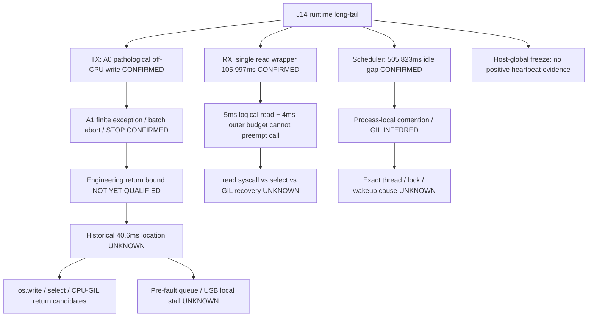

# J14-A1.1 UART TX Backpressure & Timeout Semantics Characterization

日期：2026-10-08，Asia/Shanghai。工作区 `/home/lyapunov/bone_drill`，ROS 2 Jazzy，PySerial 3.5，kernel `7.0.0-34-generic`，当前 ttyUSB0 绑定 `ch341-uart`。HEAD/分支保持 `feba8fd` / `main`，无 commit/push/tag。

当前统一 verdict：**A1-TRANSPORT：PARTIAL / NOT YET QUALIFIED；A1-RUNTIME：NOT PASS**。本报告替代 A1 报告把“40.6 > 30”用于严格 wall 判 FAIL 的口径。30 ms 是候选 transport logical timeout，不是 frozen safety threshold 或 Linux hard-real-time gate。A1 原始证据和原报告均保留。

本阶段完成源代码/容量审计、diagnostic-only queue telemetry、Mock/PTY 验证及一次最多 10 s Stage A syscall 诊断；未启动 Runner，未执行 A1-R2/R3，没有进入下一生产修改阶段。

## 1. UART Bus Budget Table

参数来自当前 production source：motor node 创建 serial 为 921600、8N1；`pack_write_register_cmd(ID, TARGET_POSITION_ADDR=0x29, [target])` 实际 10 B；命令 opcode 是 CMD_WR_REGISTER=0x32，0x29 是寄存器地址。StatusFeedback payload 12 B，加 framing 共 20 B，`unpack_status_response` 校验长度 0x0F。FakeBus 仅用于离线构造与 parser 交叉确认长度，未连接硬件。

| 项目 | TX | RX | 合计/说明 |
|---|---:|---:|---|
| Baud / framing | 921600 / 8N1 | 921600 / 8N1 | 每字节 1 start + 8 data + 1 stop = 10 bits |
| Frame bytes | 10 B | 20 B | 单轴 motion + StatusFeedback |
| Wire time/frame | 0.108507 ms | 0.217014 ms | 不含设备 turnaround / USB / OS 等待 |
| 6-axis bytes/cycle | 60 B | 120 B | 180 B |
| 6-axis wire time | 0.651042 ms | 1.302083 ms | 1.953125 ms |
| 50 Hz bytes/s | 3000 | 6000 | 9000 |
| Line bit utilization | 3.2552% | 6.5104% | 保守合计 9.7656% |
| Intra-batch inter-frame wait | — | — | 5 × 600 µs = 3.000 ms |
| Additive no-overlap bus budget/cycle | — | — | 1.953125 + 3.000 = 4.953125 ms |
| 20 ms cycle utilization | — | — | additive budget 24.7656% |

计算：bytes × 10 / baud。TX/RX 是否共享同一物理半双工线不影响低利用率判断：独立方向分别仅 3.26% / 6.51%；把两方向串行相加也是 9.77%。这里没有假定两方向可以同时发送。

600 µs 的源码约束是前次 write return 到下次 TX 的最小间隔，正常一个六轴 batch 有 5 段，合计 3 ms；另有 adapter 100 µs spacing，处于 transport 600 µs 之内，正常周期不重复相加，startup request-to-first-write 可能涉及该 adapter 间隔。

4.953 ms 是把所有 wire time 与软件 spacing 相加、不做重叠折扣的保守理论预算，不是 measured runtime 上界。若发送立即排队且每轴 response 理想地在下一次 600 µs 间隔内完成，5 × 0.6 + 0.108507 + 0.217014 = 3.325521 ms 是进一步简化的 ideal pipeline 完成时间；真实电机 turnaround/USB 时序未知，不能称其为 hardware latency。

判定：**LOW utilization（线速层）**。加入 spacing 的周期预算约 25%，仍远离结构性饱和；这不能排除局部 USB/tty 停顿、有限队列问题或线程调度异常。

[预算 JSON](../results/j14/j14_a1_1_software/uart_bus_budget.json)。

## 2. 当前安装的 PySerial 3.5 真实 timeout 语义

读取位置：`/usr/lib/python3/dist-packages/serial/serialposix.py` 与 `serialutil.py`；完整读取片段保存到 [installed_pyserial_source.txt](../results/j14/j14_a1_1_software/installed_pyserial_source.txt)。没有修改系统 PySerial 文件。

实际 write 顺序：
1. 检查 open、转换 bytes、初始化 `Timeout(self._write_timeout)`，target = monotonic + 30 ms。
2. 调用 `os.write(fd, remaining_data)`，尚未在 syscall 前等待 write-ready。fd 由 `open(..., O_NONBLOCK)` 创建。
3. finite 分支先 `timeout.expired()`；如果 os.write 返回时已到期，立即 SerialTimeoutException。
4. 否则 `select.select([abort_pipe], [fd], [], timeout.time_left())`，只传剩余预算。即使本次 os.write 已接受全部 bytes，此 select 仍会执行。
5. 没有 ready → SerialTimeoutException；abort pipe → 既有 cancellation 分支；ready → 更新剩余 bytes。
6. 循环末尾再次检查 expired；EAGAIN/EINTR 等可进入剩余预算循环；完成才返回总字节数。

结论：**B：30 ms logical timeout budget**，不是 A：30 ms hard wall deadline。没有 preemptive timer 中断 os.write、没有线程恢复执行/GIL 获取的确定时限。PySerial 调用成功也只表示 bytes 被接口接受，不能等价于全部发送到线或电机执行确认。

40.613 ms 来源是 adapter 围绕 serial.write 的 perf_counter 测量，不是逐条 Python 指令内部探针；包含少量 call-entry/CPU timer/异常传播开销，也可能包含在这些位置发生的 deschedule。adapter lock、frame interval 和本次新增 queue-before 查询处于 serial timer 之外。实际 logical Timeout 初始化又稍晚于该 outer measurement start，两个起点不能强行视为完全相同。

## 3. TX queue / backpressure evidence

新增诊断默认关闭，仅在既有 enable_runtime_diagnostics 打开时启用。读 PySerial `out_waiting`（TIOCOUTQ）和 `in_waiting`（TIOCINQ/FIONREAD），分别于 write 前、成功后或 exception 后采样。记录配置 timeout、精确 serial wall/thread CPU、wrapper wall、队列读取耗时、cycle_seq/motor_id、六轴 phase 和 callback total。无 flush/tcdrain/reset、无消费 RX 数据、无新 gate、无 retry。获取失败写空值/错误类型，不能当 0 queue。

两个 queue snapshot 查询的耗时排除在 serial-write timer 之外；仍计入 wrapper/callback。失败 snapshot 在既有 STOP writes 之前固化到 exception metric，再传给 cycle audit，避免被 pause 请求覆盖。CSV 是 `tx_queue_state.csv`，内存 ring 与现有 300-cycle buffer 对齐，不加每周期文件写入。

软件开销 benchmark：PTY 10,000 次 out_waiting/in_waiting 查询对，P50 1.511 µs、P99 1.687 µs、Max 10.369 µs，hardware_write_count=0。PTY 不代表 CH340 ioctl 的真实延迟。

唯一硬件诊断：10 s Stage A，435 个 driver 周期；完整 trace 保存，queue CSV 保留最后 300 周期（135–434），1800 次 write。所有 write-before out_waiting=0；after out_waiting=0 共 1779 次、10 B 共 21 次；没有 getter 错误，没有观察到跨帧持续积累。in_waiting 在 0–100 B 范围变化，是正常反馈到达/未消费的采样状态，没有修改 RX 策略。

写前全部为 0 只能说明这些 snapshot 没有 host-reported pending TX bytes；本次没有重现 timeout/50–296 ms long-tail，所以**Q3“原 long-tail 前是否已经积累”仍 UNKNOWN**。不能把正常运行的 0 外推到未捕获的故障，也不能排除采样之间短暂排队或 bridge 内部未报告的 UART queue。

作为语义参考，[Linux upstream USB serial generic queue 实现](https://github.com/torvalds/linux/blob/master/drivers/usb/serial/generic.c) 的 chars_in_buffer 汇总 host write_fifo 与 pending tx_bytes；它不直接测量电机侧执行状态。本机 binding 由 sysfs 确认，upstream 参考没有替代本机内核实测，也未用于宣称特定 Ubuntu kernel 的内部路径已追踪。

硬件 tracing 开启时：queue-before 查询对 P99 0.388 ms、Max 0.754 ms；queue-after P99 0.340 ms、Max 1.182 ms，明显受 tracing/调度影响。没有无 tracing 的 CH340 独立 benchmark，不能声称新增 diagnostic 的硬件开销为零。默认关闭，下一普通运行仍应避免 syscall tracing。

[硬件队列 CSV](../results/j14/j14_a1_1_stage_a_diagnostic/tx_queue_state.csv)、[分析 JSON](../results/j14/j14_a1_1_analysis/analysis.json)。

## 4. 30→40.6 ms overshoot attribution

原 A1 cycle 199 / ID1：配置 30 ms；adapter serial timer 40.613 ms，wrapper 40.673 ms、wrapper thread CPU 1.131 ms；exception、batch abort、既有 fault path 已发生。**有限受控失败 CONFIRMED；可靠 engineering wall bound 尚未 QUALIFIED**。额外约 10.6 ms 不是新 safety fault。

真实 PTY backpressure 40 次（2 MB 测试写、测试 peer 在写期间不读，不是 10 B 电机帧）：timeout 40/40，return P50 32.086 ms、P95 34.923 ms、P99 35.852 ms、Max 35.997 ms；overshoot Max 5.997 ms。没有 100–300 ms 返回样本，但仅支持 PTY 软件层结论。另一个 40-trial traced PTY 也有限返回，Max 35.578 ms。

使用当前安装的 Serial.write 做虚拟 syscall/clock injection，分别让 os.write 返回于 40.6 ms、或 select 对剩余 29 ms 预算在 39.6 ms 后返回，都能生成 30→40.6 ms exception。是语义验证，不是对历史硬件事件的复现或归因。

Tracing overhead：1000 次 10 B PTY write + test-peer read 循环，untraced 总 5.366 ms、traced 总 79.155 ms，平均多 73.789 µs/次、约 14.75 倍。单次比较有普通 run-to-run variation，不能当普适开销常数。系统调用 trace 只用于这一次短诊断，不能据 trace run 宣称资格 PASS 或吞吐优化。

新硬件诊断没有 timeout：全部 435 周期的六轴 phase Max 13.758 ms，retained 1800 次 serial write P50 0.173 ms、P99 0.465 ms、Max 2.259 ms。它没有覆盖历史故障条件，**没有获得新的 observed_timeout_return_wall_ms sample**。

| 新 trace 例子（不同于原 timeout） | serial wall | os.write syscall interval | TX pselect6 interval | first syscall 之前间隔 |
|---|---:|---:|---:|---:|
| cycle 209 / ID1 | 2.259051 ms | 1.810 ms | 0.047 ms | 0.062962 ms |
| cycle 421 / ID1 | 1.996911 ms | 0.097 ms | 0.025 ms | 1.649754 ms |

这确认新样本的较长 write wall 可以发生在 syscall interval 或首次 syscall 前的 Python/call-entry 区间。strace <duration> 包含内核运行/等待并受 ptrace/调度影响，不能直接等价为 USB TX stall；syscall 前间隔也不能区分是在 serial.write 函数入口前、PySerial Python 前缀中，还是 CPython syscall wrapper 进入内核前。epoch/perf offset 的首尾漂移仅 -1.705 µs，已用于对齐。

当前 trace 的 servo-thread 最大 serial os.write interval=1.810 ms，TX-select=0.261 ms，read=0.173 ms，RX-select=0.336 ms，queue/read-availability ioctl=1.131 ms。只有正常 samples，不能解释原 10.6 ms。

| 候选层 | 当前证据等级 | 结论 |
|---|---|---|
| A. Python scheduling / call entry | 可能性 INFERRED；新 trace 前缀间隔 CONFIRMED | 原 40.6 ms 是否在此 UNKNOWN |
| B. os.write syscall | 新 trace 可含较长 interval CONFIRMED | 原事件是否在此 UNKNOWN |
| C. select wait | 安装源码逻辑 CONFIRMED | 原事件 syscall timing UNKNOWN |
| D. 到期后的 CPU/GIL 恢复 | 非 RT logical timeout 允许超额 CONFIRMED；实际归因 INFERRED | 是合理候选，不具有排他性证据 |
| E. Linux tty TX queue backpressure | 正常 snapshot 未积累 CONFIRMED | 故障前 queue 状态 UNKNOWN |
| F. USB/driver local stall | 未采集 URB/driver fault 证据 | UNKNOWN |

Q2 答案：**无法可靠排序原 10.6 ms 最可能属于哪一层；具体 attribution UNKNOWN**。wait/wakeup/GIL 超额是合理 INFERRED 解释，不能直接认定 PySerial 无效、os.write 被卡住或 CH340 满队列。

[syscall 对齐 CSV](../results/j14/j14_a1_1_analysis/write_syscall_alignment.csv)。

## 5. RX ≈106 ms blocking classification

当前 serial read timeout = min(5 ms, p_timeout)；当前 params p_timeout=50 ms，因此有效 5 ms。J7UartAdapter 的 timeout_s=10 ms 是 request response 外层预算，不能当成 serial.read timeout。motion feedback drain 的 4 ms deadline 是 send_cycle 的 drain loop 外层 deadline。

调用链：send_cycle → drain_fn() → adapter.drain_motion_feedbacks → _ingest_available_locked → _read_chunk → serial.read(size=in_waiting)。在 drain_fn 返回后，外层才检查六轴反馈完整性/4 ms deadline；单次 drain_fn、其内部循环和单次 read 都可能越过该外层预算。

安装的 Serial.read 先创建 5 ms logical Timeout，然后 select(remaining budget) → os.read → expiry check。与 write 一样不能保证线程在 5 ms 恢复，外层 4 ms 也不能 preempt 内层 call。

原 cycle 90：callback 113.414 ms、TX 4.048 ms、RX/drain 108.941 ms；独立 drain CPU 4.850 ms，max single serial.read wrapper 105.997 ms。**RX path 存在独立于 TX 的 off-CPU long-wall read/wait 现象 CONFIRMED**。具体阻塞位置（select、read syscall、GIL/调度恢复）仍 UNKNOWN，不能把 wrapper 106 ms 直接叫“kernel read 106 ms”。

RX NEXT-BRANCH CANDIDATE：**CONFIRMED（异常路径/现象层）**，尚未确认独立的内核/USB 根因。本轮 read timeout/drain policy 完全未修改。

## 6. Scheduler ≈505 ms event classification 与 CPU 采样区间纠正

源码 start_cycle 在 entry 读取 thread/process CPU 及 context switches，并减去前次 entry 读数；finish_cycle 不更新它们。因此 cycle N 中这几列覆盖 entry(N-1)→entry(N)，不是 entry(N)→exit(N)。这纠正 A1 报告中把 cycle 90 的 6.774/8.342 ms 与其 113.414 ms callback 直接并列的解释。原 CSV 不变，源代码不变。

cycle 14 entry=2944142228902 ns，exit=2944148453550 ns；cycle 15 expected wake=2944162169818 ns，actual entry=2944654276237 ns，exit=2944661970954 ns；cycle 16 entry=2944662017162 ns。

| 量 | 采样区间/数值 | 证据 |
|---|---|---|
| cycle 14 callback | 6.225 ms | CONFIRMED |
| cycle 14 exit → cycle 15 entry | 505.823 ms idle gap | CONFIRMED |
| cycle 15 expected wake → actual entry | 492.106 ms lateness | CONFIRMED |
| cycle 15 callback | 7.695 ms；TX 4.318、drain 2.537 ms | CONFIRMED，505 ms 不在当前 TX/RX callback 内 |
| watchdog scheduler gap | 513.096 ms | CONFIRMED，距前次 ingest 完成 |
| entry 14 → entry 15 CPU sampling span | wall 512.047335 ms，thread CPU 13.717、process CPU 532.388 ms | CONFIRMED，含前次 callback 和 idle gap，不含当前 callback |
| 同区间 context switches | voluntary 1640、involuntary 0 | CONFIRMED，不足以单独确定锁/GIL 地址 |
| cycle 15 exit → cycle 16 entry | 0.046 ms | CONFIRMED，随后周期恢复 |
| 独立 heartbeat | 0 个 >20 ms 事件 | CONFIRMED，仅说明 observer 没记录该级 stall |

同一进程的其他线程有显著 CPU activity；process CPU 可因多线程多核心累计而大于 wall。大量 voluntary switches 与很小 servo CPU、独立 heartbeat 未停顿，使 process-local contention/GIL/wakeup delay 比“整个 host 冻结”更符合已有事实（INFERRED）。无法确定是哪条线程、何种锁、OS runqueue 或 GIL；没有 futex/GIL/syscall trace 覆盖这次历史 gap，所以根因 UNKNOWN。

cycle 90 callback 的紧邻采样区间是 entry90→entry91：wall 113.461442 ms，cycle91 row thread CPU=8.719 ms、process CPU=120.447 ms；独立 drain CPU=4.85 ms。相对于 servo CPU，同进程其他线程 CPU 活跃，支持 GIL/local contention 候选；也可与 syscall wait 并存，不能因 CPU activity 宣称 GIL CONFIRMED。

[历史事件时间线 JSON](../results/j14/j14_a1_1_analysis/historical_event_timeline.json)。

## 7. 当前 J14 root-cause tree

## 8. 推荐的唯一下一 modification

**RX/Drain 分支：只给现有单次 serial.read wrapper 增加精确同区间 thread CPU、process CPU 和 context-switch telemetry（已有 wall timer 保留），并与原有 cycle/phase 关联。** 属于诊断修改，不改变 RX timeout、drain policy、Executor、GIL、线程优先级或 safety。本轮没有实施该下一修改。

这不是现在直接实施 nonblocking RX 或 custom TX：现有 source 表明 read 本身已经有 finite logical timeout 和 O_NONBLOCK fd；106 ms wrapper 可能来自 select/read 或恢复执行。仅把 5 ms 改成 0 并不能根据现有数据保证消除恢复延迟。先用最小精确采样区间区分同进程忙碌与 kernel wait，避免同时改 RX 与 scheduler。

## 9. 决策问题与原因

| 问题 | 回答 |
|---|---|
| Q1：30 ms 已把 100–300 ms TX 变成工程 bounded failure？ | finite controlled exception/abort 已确认；可靠 wall 上界尚未证明，PARTIAL / NOT YET QUALIFIED。一个原 timeout sample 和本次没有 timeout 不能做统计上界。 |
| Q2：额外约 10.6 ms 最可能哪层？ | 具体 UNKNOWN；os.write、select、Python/GIL 恢复均兼容证据。wait/wakeup overshoot 是合理 INFERRED 候选，不能排他排序。 |
| Q3：TX queue 是否在 long-tail 前积累？ | UNKNOWN。本次正常 snapshot 写前全0，未捕获故障前 snapshot；没有支持持续 backpressure 的新证据。 |
| Q4：50 Hz 是否结构性饱和？ | LOW utilization，原始合计 wire 9.7656%，含spacing保守cycle预算24.7656%，无结构性线速饱和证据。 |
| Q5：TX 下一选择 A/B/C/D/E？ | **A：继续使用 PySerial finite timeout 30 ms。** 当前没有依据增大budget、修改recoverable partial transaction语义、custom write或直接修queue。仍未qualification。 |
| Q6：RX106是否第二个 confirmed mechanism？ | RX long-wall/off-CPU read path CONFIRMED；是否第二个独立 kernel/USB 根因 UNKNOWN。 |
| Q7：505ms gap 能否归因？ | gap在callback外 CONFIRMED；process-local/GIL候选 INFERRED；具体原因 UNKNOWN。 |
| Q8：下一实际修改哪支？ | **RX/Drain 的单调用诊断 telemetry**，用已确认106ms事件作为目标；不是先改RX行为或Scheduler架构。 |

唯一下一修改的理由：RX 有明确异常 call 与相邻 CPU activity，但现有 CPU 统计跨 entry，尚不足以唯一确认 call 内部机制。补三个同区间计数器比改 transport、恢复策略或调度架构更小，且回答当前证据缺口。

## 10. 软件、硬件边界与 Git status

软件：py_compile PASS；pus6_motor_driver colcon build PASS；相关 J14 tests 21 PASS；两包全回归 555 PASS、0 error/failure/skip。软件/Mock/PTY/offline hardware_write_count=0；未修改系统 PySerial。新增8项测试覆盖队列可选开关、bytes不变、查询错误不mask write timeout、查询耗时剥离、成功/超时CSV关联和installed源码logical semantics。

本轮 tracked 增量只有 adapter、transport audit、motor node 的 diagnostic 开关、recorder 导出共四文件。新增诊断执行脚本、离线分析脚本、测试、本报告及新 `results/j14/j14_a1_1_*` 证据。既有 A0/A1/J2测试修正保持。完整 diff 含既有未提交修改，不能全算成本次 A1.1。

硬件：仅一次 10 s Stage A diagnostic；435周期、2610次servo-thread motion writes；未进入Runner ACTIVE；0 timeout/driver STOP/hard stop/motor fault log，heartbeat0。运行在主动诊断时限结束时被SIGINT停止；没有按283.3ms warning增加停止条件。

关闭过程中出现既有 ROS SIGINT teardown 日志：duplicate rcl_shutdown、其他节点 KeyboardInterrupt、context invalid publication。它们发生在主动停止之后，本轮未修 shutdown code，也不能把它们当 UART timeout/safety fault。日志明确执行 J7 shutdown 0x1A stop_all，最后 relevant process=0、串口owners为空；所有资源释放。实机StopAudit ACK未单独持久化，不能宣称每轴pause ACK都硬件确认。

本次观测改变了微小时序：tracing run callback/TX/RX分位数只作为diagnostic，不当作A0/A1严格before-after或runtime PASS。更多真实 timeout sample 仍缺失，本轮最大一次硬件机会已用完，不追加试验。

[软件验证](../results/j14/j14_a1_1_software/verification.json)、[硬件 metadata/cleanup](../results/j14/j14_a1_1_stage_a_diagnostic/run_metadata.json)、[硬件日志](../results/j14/j14_a1_1_stage_a_diagnostic/robot.log)。

`main` / HEAD unchanged / 未stage；tracked修改共9文件，含先前A0/A1；新增A1.1文件未跟踪。[最终git status](../results/j14/j14_a1_1_software/git_status_final.txt)、[完整diff](../results/j14/j14_a1_1_software/git_diff_final.patch)。`git diff --check` PASS。

**Commit NO / Push NO / Tag NO。30 ms不变，safety/J13 controller/IK/FK/shaping/RX policy/feedback scheduler/QoS/Executor/thread priority不变。A1-TRANSPORT PARTIAL / NOT YET QUALIFIED；A1-RUNTIME NOT PASS。完成本诊断后停止，下一推荐修改没有实施。
