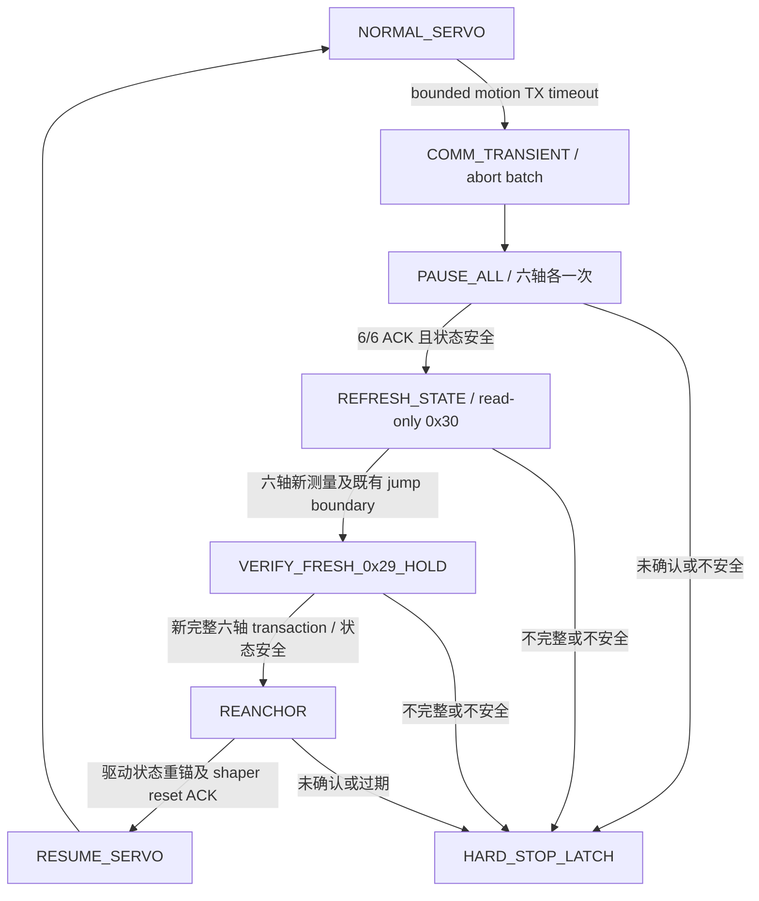

# J14-A1.3 Recoverable Communication Timeout Handling

2026-10-08，`main`，HEAD `feba8fd00c392ecaab93b53138db7c1d06bce000`。

本阶段已完成实现、软件验证和唯一一次 Stage A R1。**软件 PASS；完整通信恢复硬件 FAIL**：真实 timeout 后正确 abort，6/6 pause ACK 已持久化，但 fresh-state acquisition 不完整，系统按设计进入 latched STOP。没有重启、追加真机 run、进入 LADRC ACTIVE 或在硬件失败后修改 production source。

| Verdict | 结果 |
|---|---|
| COMMUNICATION RECOVERY SOFTWARE | **PASS** |
| COMMUNICATION RECOVERY HARDWARE | **FAIL** |
| A1-TRANSPORT | **PARTIAL / NOT YET QUALIFIED** |
| A1-RUNTIME | **NOT PASS** |

## 1. 最小接入点与 state machine

只将生产 driver 的 **0x29 motion batch `J7AdapterWriteTimeout`** 接入 recoverable communication 路径。configuration、非 timeout 写错误、pause/refresh/verification 失败、hardware fault 等仍走 hard STOP。底层 standalone transport 的默认 legacy STOP 行为保留，生产 J7 node 显式启用新路径。

timeout 当次保存 failed audit、delivery uncertainty、sent/attempted/unsent IDs 后抛出；不继续 batch，不重试失败帧。`communication_transient` 阻止直接进入下一正常 motion cycle；只有确认过的独立 recovery verification audit 能解除它，不能使用旧 transaction snapshot 清除。

没有 timeout 时，已有 motion frames、顺序、UART timing 配置及 RX/drain 算法保持。`recovery_count` 仅诊断计数，没有新增次数上限或 scheduler performance gate。

## 2. 修改文件

本阶段 tracked source 增量四个文件：

| 文件 | 内容 |
|---|---|
| [j7_real_uart_adapter.py](/home/lyapunov/bone_drill/bone_ws/src/pus6_motor_driver/pus6_motor_driver/j7_real_uart_adapter.py) | pause ACK 必须匹配 ID、CMD_WR_REGISTER、0x1A；记录 request/response hex、状态、时间、错误；成功恢复后建立新的 pause epoch |
| [j7_six_axis_servo_transport.py](/home/lyapunov/bone_drill/bone_ws/src/pus6_motor_driver/pus6_motor_driver/j7_six_axis_servo_transport.py) | bounded motion timeout 的 transient 状态；独立 measured-position hold 验证与受限 resume；其他 stop 行为保留 |
| [motor_driver_node.py](/home/lyapunov/bone_drill/bone_ws/src/pus6_motor_driver/pus6_motor_driver/motor_driver_node.py) | recovery 接入、期间丢弃积累的 ingress、驱动 command continuity 重锚、上游 reset 握手、pause evidence 持久化 |
| [control_node.py](/home/lyapunov/bone_drill/bone_ws/src/pus6_control/pus6_control/control_node.py) | recovery 专用 reset/ACK 接入，调用现有 `controller.reset()`；丢弃旧 target，清零 shaper 速度/加速度等状态 |

新增 [communication_recovery.py](/home/lyapunov/bone_drill/bone_ws/src/pus6_motor_driver/pus6_motor_driver/communication_recovery.py)、[driver recovery tests](/home/lyapunov/bone_drill/bone_ws/src/pus6_motor_driver/test/test_j14_a1_3_communication_recovery.py)、[shaper reset tests](/home/lyapunov/bone_drill/bone_ws/src/pus6_control/test/test_j14_communication_reanchor.py)、[Stage A 脚本](/home/lyapunov/bone_drill/bone_ws/scripts/j14_a1_3_stage_a.py)、本报告及 A1.3 结果目录。

新增握手 topic 为 `/pus6/communication_reanchor` 和 `/pus6/communication_reanchor_ack`，使用 `Int64MultiArray` 携带 recovery epoch 与六轴 measured steps。没有修改现有 topic 的名称、类型、QoS 或发布频率。ACK 必须匹配本次 epoch 和六轴位置；过期或冲突的 anchor 不被接受。

## 3. Pause 与 Fresh Feedback 的语义

pause 使用原有六轴 0x1A request，逐轴零 retry。保存完整 `StopAudit` 到 **`stop_pause_audit.jsonl`**，包括每轴请求和响应 hex、request/response interval、ACK、timeout/error 和解码状态。任一轴未确认或测得 fault/current/position 不安全，不允许继续 recovery。

现有 StopAdapter 的一次性保护现在是 **每个成功恢复 epoch 一次**。只有完成所有恢复条件后才 re-arm；failed recovery 的 shutdown 使用已经确认的同一 pause audit，不再重复发送 pause。

fresh 0x29 feedback 有一个实际协议前提：它由 target-register 写产生，不能凭空被动取得。因此先在 6/6 pause barrier 后，使用现有 adapter request/parser 做 **六轴 read-only 0x30 status bootstrap**，取得新测量位置。安全验证及 jump 检查通过后，再发送一笔 **新 cycle ID、以新测量位置为 target 的完整零跳变 hold transaction**，确认新 0x29 feedback。

这不是重发旧目标或补齐失败 batch。若 measured target 恰好与旧目标数值相同，线上的 bytes 可以相同，但它的许可依据是 pause 后完整新状态，transaction 身份及用途也不同；不能将它当成 blind retry。

verification 的 0x29 status 必须完整 6/6、target echo 匹配 measured hold、fault/current/position 安全、host acquisition epoch 在 pause barrier 后。保存 read-only request/response 时间、原始响应、verification sequence/start/end、fresh status、fresh positions 和反馈采样时间。feedback 时间是 host 采样边界，不是 device timestamp；现有 0x29 汇聚后的采样时间可以对六轴相同。

normal RX read size/timeout、parser、drain loop、deadline、busy-wait 都未改。ACK 的严格匹配属于恢复确认语义，不是新的 RX/drain 策略。

## 4. Re-anchor 和 80-step rule

先将恢复时的 candidate 与完整 fresh measured state 对比，继续使用 node 原有 `reconnect_max_jump_steps`（当前冻结配置为 80）。超过边界即 recovery reject，不能通过把 command 强制改为 measured baseline 来绕过检查。

满足条件后，驱动清除旧 latest target，将 last-commanded 与 continuity anchor 改为 fresh positions；恢复期间收到的旧 shaper command 不积累。上游使用已有 reset API 重置 q、dq、ddq、dddq，目标也改为 measured baseline，更新 control 时间基准；driver 收到匹配 ACK 后才恢复。后续 ingress 继续复用原有 stream timeout recovery admission。

没有修改 Classical/LADRC、IK/FK 或 shaper update 算法。增加的是通信恢复所需的状态重置，不应把它描述成整个异常路径完全没有语义变化。没有改 Executor、callback group、thread priority/affinity 或现有 QoS。

已有 283.3 ms warning、1000 ms hard stop、1500 mA 与 80-step boundary 保持。新状态仍通过原有 feedback validation/watchdog；没有重置旧 watchdog 时间来掩盖超限。等待上游 reset ACK 也受现有 freshness hard-stop 时间约束。

## 5. 软件验证和 regressions

`py_compile` PASS；`colcon build --symlink-install --packages-select pus6_motor_driver pus6_control` PASS。三个相关包的完整 pytest：**606 passed，0 failure/error/skipped，43.62 s**，覆盖 pus6_motor_driver、h30_imu、pus6_control 及其 J7/J11/J13/J14 测试。软件运行使用独立 ROS_DOMAIN_ID=179，**hardware_write_count=0**。

新增 26 个 test cases 覆盖：normal path、ID1/3/6 timeout 的 abort 与新 transaction、pause missing/wrong-register ACK、bootstrap/0x29 feedback incomplete、fault/1501 mA/invalid position、verification timeout、80 accepted/81 rejected、reset ACK missing、三个连续独立成功 recovery 无计数 gate、非 timeout hard stop、旧 snapshot reject、1000 ms watchdog 保留、pause audit 持久化，以及完整 ROS driver→control reset→ACK→下一 servo cycle 的 Mock 集成。

对 pre-stage working tree 在内存重建并进行 AST 比较：adapter 的 read/request/RX drain、transport 的 drain/wait、driver safety preflight/vector slew、control loop/desired-input 算法保持。其他既有 tracked edits 的 diff 保持。

验证证据：[pytest_final.log](/home/lyapunov/bone_drill/results/j14/j14_a1_3_software/pytest_final.log)、[pytest_final.xml](/home/lyapunov/bone_drill/results/j14/j14_a1_3_software/pytest_final.xml)、[colcon_build.log](/home/lyapunov/bone_drill/results/j14/j14_a1_3_software/colcon_build.log)、[scope_audit.json](/home/lyapunov/bone_drill/results/j14/j14_a1_3_software/scope_audit.json)。

软件过程中发现并修正一项归档问题：一个 ACTIVE-mode 测试注入了 Mock bus，其新生成的 pause audit 误用了历史 run pointer。该文件已移到本阶段软件目录 [mock_pause_audit_misrouted.jsonl](/home/lyapunov/bone_drill/results/j14/j14_a1_3_software/mock_pause_audit_misrouted.jsonl)，并补充 backend-aware 输出隔离和回归测试。原 `j14_real_failure_ladrc` 现场恢复为原有 10 文件，原始文件未改写；本轮新审计不当成历史硬件证据。

## 6. Hardware R1：一次，提前结束

运行目录：[j14_a1_3_r1_stage_a_30s](/home/lyapunov/bone_drill/results/j14/j14_a1_3_r1_stage_a_30s)。最长授权 30 s；实际启动至清理 **5.201332 s**，记录 **188 cycles（0–187）**。第一次 recovery failure 即结束。没有 Runner、LADRC ACTIVE、双 IMU 或第二次 hardware run。

Stage A 使用原 J13 config、active/maintenance、dedicated_thread、async_latest、age_based 和现有 instrumentation。启动前进程为空、三个串口 free；安装路径已确认指向最新构建源码。

| 首个 timeout | 实测 |
|---|---:|
| cycle_seq / motor_id | **187 / ID6** |
| configured timeout | **30 ms** |
| serial write start/end ns | 9464994980191 / 9465041335749 |
| serial wall / CPU | **46.355558 / 1.147487 ms** |
| wrapper wall | **47.325617 ms** |
| sent IDs / uncertain ID / unsent IDs | 1–5 / 6 / 无（ID6 为最后一轴） |
| out_waiting before/after | **0 / 0 bytes** |
| in_waiting before/after | **96 / 120 bytes** |
| TX phase / callback | **50.653 / 281.729 ms** |
| recovery_count | **1** |
| recovery duration | **227.042514 ms** |
| 最终状态 | **HARD_STOP_LATCH / communication_recovery_failed** |

write process CPU/CS 没有同区间采样；cycle CPU 是 entry-to-entry，不能代替它。fault cycle 的 scheduler/feedback age 默认零值也不能作为健康值。

## 7. R1 pause evidence

6/6 responses 均匹配 **对应 ID / 0x32 / 0x1A**，checksum/parser 验证通过；timeout=false、error=null，current=0 mA、fault=0。

| ID | request start ns | ACK end ns | measured steps |
|---:|---:|---:|---:|
| 1 | 9465043980308 | 9465047017129 | 1000 |
| 2 | 9465047036791 | 9465049860346 | 999 |
| 3 | 9465049878140 | 9465052561213 | 1000 |
| 4 | 9465052573819 | 9465055536084 | 999 |
| 5 | 9465055555556 | 9465058463091 | 1000 |
| 6 | 9465058482698 | 9465061211833 | 1001 |

pause barrier 为 **9465061211833 ns**。原始请求/响应及状态见 [stop_pause_audit.jsonl](/home/lyapunov/bone_drill/results/j14/j14_a1_3_r1_stage_a_30s/stop_pause_audit.jsonl)。这是命令 ACK 和反馈确认，没有额外外部机械位移测量。

## 8. R1 first failed recovery stage

`REFRESH_STATE` 取得了 pause barrier 后的四轴新 0x30 状态：

| ID | request ns | response ns | measured steps | current / fault |
|---:|---:|---:|---:|---:|
| 1 | 9465061891966 | 9465064883156 | 1000 | 0 / 0 |
| 2 | 9465064933240 | 9465067676022 | 998 | 0 / 0 |
| 3 | 9465067707640 | 9465070430409 | 1000 | 0 / 0 |
| 4 | 9465070469001 | 9465073375040 | 999 | 0 / 0 |
| 5 | failed request 行未持久化 | 未取得确认 | UNKNOWN | UNKNOWN |
| 6 | 此轮 refresh 未执行 | 未取得确认 | UNKNOWN | UNKNOWN |

按串行 ID1→6 顺序和四项成功 acquisition，可定位到下一项 **ID5 read-only status request**；异常是 **J7AdapterTimeout: UART response timeout**。失败请求自身的精确起止、write metric 及具体 syscall 份额没有保存，不能补造。四个真实 0x30 响应的 register=0 与本次预期匹配，不支持直接归因于 register-match 错误。

ID4 response 到 HARD_STOP checkpoint 之间约 197.485 ms，包含下一 request 的执行与等待等，**不能当成单次 serial.read wall**。本次整个 run 最大 read 0.999238 ms，fault cycle 最大 read 0.274476 ms，Tier 2 >5 ms read events 为 0；没有本轮 single-read pathological tail 的证据。

由于未建立六轴完整 fresh state：**0x29 measured hold 没有执行、80-step 六轴检查没有完成、re-anchor/上游 reset ACK 没有执行、resume 没有执行**。失败应定位在 REFRESH_STATE，不应称为 shaper 或 controller failure。

| 状态 checkpoint | monotonic ns |
|---|---:|
| COMM_TRANSIENT | 9465043806173 |
| PAUSE_ALL | 9465043924514 |
| REFRESH_STATE | 9465061737586 |
| HARD_STOP_LATCH | 9465270859758 |

完整各阶段快照：[communication_recovery_events.jsonl](/home/lyapunov/bone_drill/results/j14/j14_a1_3_r1_stage_a_30s/communication_recovery_events.jsonl)，离线汇总：[analysis.json](/home/lyapunov/bone_drill/results/j14/j14_a1_3_analysis/analysis.json)。阶段记录是同一个 recovery_count 的累积快照，不能把每行算成一次 recovery。

## 9. Cleanup 和 remaining issues

唯一一次 six-axis pause 已确认并持久化。failed recovery 没有 re-arm pause epoch，shutdown `stop_all` 使用该缓存 audit，未再发送一轮 pause。没有 blind retry、继续 partial batch 或后续 motion cycle。

最终 residual_processes=[]、三个 serial resources free：**受控 pause 与资源释放确认通过**。日志同时记录 motor、control、kinematics 的 **`rcl_shutdown already called on the given context`**；pause path 已执行，异常位于其后的显式 context shutdown。launcher exit code=0 不代表干净退出。该 shutdown 代码未在本阶段修改，未继续修复此问题。

证据：[robot.log](/home/lyapunov/bone_drill/results/j14/j14_a1_3_r1_stage_a_30s/robot.log)、[run_metadata.json](/home/lyapunov/bone_drill/results/j14/j14_a1_3_r1_stage_a_30s/run_metadata.json)、[final_cleanup_check.json](/home/lyapunov/bone_drill/results/j14/j14_a1_3_analysis/final_cleanup_check.json)。

本次 heartbeat stalls >20 ms 为 0；最大 idle 53.597 ms、wake lateness 45.589 ms、drain 3.315 ms。历史 335/505/185 ms idle、57/106 ms read、130 ms drain tail 仍未修复或重新 qualification。当前 fresh-state response timeout 的机制未知，不能直接把它升级为 RX read、GIL、Executor 或 USB 根因。

## 10. Git 和结束边界

`git diff --check` PASS；本阶段前的其他 tracked edits 保留。当前 main 上 **10 个 tracked modified files**（含原有 9 个和新增修改的 control_node）；A1.3 module/tests/script/report/results 未跟踪。完整状态：[git_status_final.txt](/home/lyapunov/bone_drill/results/j14/j14_a1_3_software/git_status_final.txt)。没有 reset/checkout/commit/push/tag。

**COMMUNICATION RECOVERY SOFTWARE PASS；HARDWARE FAIL；A1-TRANSPORT PARTIAL / NOT YET QUALIFIED；A1-RUNTIME NOT PASS。** 硬件验证仅确认 abort、pause 审计和不满足 fresh-state 条件时的禁止恢复。完整成功 recovery 尚未硬件验证。本阶段在首次失败后停止，未追加 run，也未修改参数或 production source 继续尝试。
