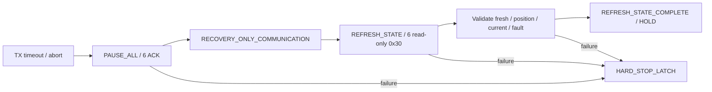

# J14-A1.4 Post-Pause Fresh-State Recovery

2026-10-08，`main`，HEAD `feba8fd00c392ecaab93b53138db7c1d06bce000`。

**REFRESH_STATE software PASS；hardware R1 PASS。唯一一次真实 timeout 后，batch abort、6/6 pause ACK、6/6 fresh-after-pause 状态全部确认，终点为 HOLD。未执行 0x29 measured hold、re-anchor 或 resume，未追加真机运行。**

A1.3 的历史结论保持：Communication Recovery Software PASS；完整 Communication Recovery Hardware FAIL。A1.4 只证明暂停后的状态获取，不将此前完整恢复改判为 PASS。

## 1. A1.3 实际失败位置与根因证据边界

已只读审计 A1.3 recovery event、pause audit、bootstrap status、robot/launcher log、cycle/transport timing、RX telemetry、fault snapshot 和 cleanup metadata。没有修改原始现场。完整 monotonic 时间线：[a1_3_monotonic_timeline.csv](/home/lyapunov/bone_drill/results/j14/j14_a1_4_software/a1_3_monotonic_timeline.csv)；审计：[a1_3_readonly_audit.json](/home/lyapunov/bone_drill/results/j14/j14_a1_4_software/a1_3_readonly_audit.json)。

现场链为 `cycle187/ID6 TX timeout → abort → 六轴 pause ACK → 只读0x30 ID1–4状态成功 → 下一项ID5匹配响应等待超时 → HARD_STOP_LATCH`。

| A1.3 checkpoint | monotonic ns |
|---|---:|
| TX timeout serial end | 9465041335749 |
| COMM_TRANSIENT / abort 已由 transport 抛出 | 9465043806173 |
| PAUSE_ALL start | 9465043924514 |
| 最后 ID6 pause ACK / pause barrier | 9465061211833 |
| REFRESH_STATE start | 9465061737586 |
| ID1 fresh 0x30 request → response parsed | 9465061891966 → 9465064883156 |
| ID2 | 9465064933240 → 9465067676022 |
| ID3 | 9465067707640 → 9465070430409 |
| ID4 | 9465070469001 → 9465073375040 |
| ID5 | request/response 精确时间 UNKNOWN；下一顺序请求超时 INFERRED |
| HARD_STOP_LATCH | 9465270859758 |

**已确认的失败机制是 read-only 状态事务没有取得匹配响应，不能直接升级为“电机没回包”或 parser/GIL/USB 根因。** ID5 失败请求没有持久化 raw RX、write metric 或 request audit，因此 B（未响应）、C（未形成匹配帧）、H（stale处理）、I（等待窗口/调度）在该历史现场仍不能精确分开。原 run 最大 read 为0.999238 ms，故障 cycle 最大read为0.274476 ms；ID4 response 到 HARD_STOP 的197.484718 ms不是单次read wall。

实际协议纠正：`0x29` 是目标位置寄存器写入，其 status 是写入的伴随响应；read-only feedback query 是 `0x30`。A1.3 REFRESH_STATE 主动逐轴请求0x30，而非依赖下一正常 servo cycle、topic或cache。没有0x29 query不是该失败的原因。

| 代码路径问题 | 审计结论 |
|---|---|
| 主动 poll 6轴？ | 是，ID1→6串行 direct bus transaction；失败停在下一项ID5 |
| 是否依赖 normal cycle？ | 否，servo worker 当前仍在同步 recovery 内执行 request |
| timeout前置 transport.stop？ | recoverable timeout只设置 communication_transient 并abort；不调用stop |
| STOP latch先阻断refresh？ | 否；writer/feedback未stopped才能进入pause；hard stop在refresh失败后 |
| pause后通信仍活着？ | 是，真实四轴0x30响应已证明；串口未关闭 |
| transport.stop是否持久？ | 是，设置_stopped并阻止send_cycle；原direct bus不是由它关闭，但不允许已hard stopped的恢复 |
| motion inhibit与communication disable错误耦合？ | 未发现该架构冲突；normal motion的transient gate和direct状态请求已分离 |
| 原freshness判定 | pause ACK最大tx_end形成barrier，bootstrap request_ns必须晚于barrier；后续0x29验证尚未执行 |
| sequence/epoch错误？ | 没有触发证据，失败发生在取得完整状态之前 |

## 2. 最小修改及资格边界

代码确认一个可复现的完成判定缺口：原request循环先判断deadline、随后才读RX。一次sleep/descheduling跨过deadline，已缓冲的正确响应可能完全未被收集就报timeout。软件测试以相同FakeSerial/virtual clock复现原方法超时而缓冲20字节完整response仍在，新recovery-only方法一次收集后完成。**这证明代码缺口，不能补证它就是A1.3 ID5根因。**

新方法仅用于A1.4 recovery-only状态：复用现有 serial.write、read chunk与parser；六轴每轴一笔0x30、零retry。先清除pre-query完整帧及半帧，不读取旧feedback cache；记录request开始、TX成功/失败、原始RX、parser形成的帧、匹配帧实际read结束时间、deadline与验证结果。最终timeout判定前检查当前可读RX，不增加sleep等待，不增大TX/RX timeout；已有1000 ms边界仍由失败前真实feedback/scheduler epoch限制，未重置旧watchdog。

成功状态：

**HOLD表示继续保持已确认的pause，绝非再发送目标位置hold。** transport的recovery_feedback_only禁止send_cycle、verify_recovery_hold、complete_communication_recovery；driver的HOLD标记阻止后续正常cycle和target ingress。re-anchor callback不会被调用，已有controller/shaper状态及servo target不重写。

| 本阶段修改文件 | 增量 |
|---|---|
[j7_real_uart_adapter.py](/home/lyapunov/bone_drill/bone_ws/src/pus6_motor_driver/pus6_motor_driver/j7_real_uart_adapter.py) | 新增recovery-only只读事务、逐步审计、最终RX收集 |
[j7_six_axis_servo_transport.py](/home/lyapunov/bone_drill/bone_ws/src/pus6_motor_driver/pus6_motor_driver/j7_six_axis_servo_transport.py) | recovery-only状态/query许可；强制禁止所有target/自动resume |
[communication_recovery.py](/home/lyapunov/bone_drill/bone_ws/src/pus6_motor_driver/pus6_motor_driver/communication_recovery.py) | opt-in fresh_state_only分支、逐轴新采样验证、终止于HOLD |
[motor_driver_node.py](/home/lyapunov/bone_drill/bone_ws/src/pus6_motor_driver/pus6_motor_driver/motor_driver_node.py) | 阶段选择、更新新反馈cache、HOLD后禁止motion；不重置command/shaper |
[test_j14_a1_4_fresh_state.py](/home/lyapunov/bone_drill/bone_ws/src/pus6_motor_driver/test/test_j14_a1_4_fresh_state.py) | 新增16个软件cases |
[j14_a1_4_fresh_state.py](/home/lyapunov/bone_drill/bone_ws/scripts/j14_a1_4_fresh_state.py) | 单次最长10秒，成功HOLD/首次失败即SIGINT退出；无injection |

本阶段专用harness在子进程设置 `PUS6_J14_RECOVERY_STAGE=fresh_state_only`；该选择已记录到R1 metadata，事件终点为HOLD。普通launch仍保留A1.3默认实现；本轮PASS只覆盖专用A1.4路径，不能声称默认launch的完整恢复已验证。

TX30 ms、serial RX5 ms、普通request10 ms、normal drain4 ms、80-step、283.3 ms warning、1000 ms hard stop、1500 mA保持；正常read/request/drain与未涉及方法AST一致，其他既有tracked edits diff一致。未修改protocol.py/uart_bus.py/motor.py、controller、IK/FK、shaper、re-anchor、Executor/QoS或scheduler算法。

## 3. 软件测试

两个受影响包pus6_motor_driver/pus6_control回归 **410 passed / 42.52 s**。新增16 cases在其中；随后匹配帧采样时间的记录细化后，最终源码A1.4+A1.3针对性测试 **39 passed / 0.63 s**。不把两次计数相加。py_compile、colcon build两包、安装模块realpath、git diff --check PASS。全部软件使用FakeBus/FakeSerial及独立ROS_DOMAIN_ID179/180，**hardware_write_count=0**。

| 要求 | 实际覆盖 |
|---|---|
| A：6/6新状态 | ID1/3/6 timeout后六轴新状态；zero-motion HOLD |
| B/F：5/6、query timeout | ID6缺失匹配response；前5轴记录；FAIL且无继续motion |
| C：6轴stale timestamp | 预备完整六轴旧状态；第一项早于barrier即拒绝 |
| D：stale cache + fresh | 完整旧cache和partial frame排除；接受新query结果 |
| E：motion stopped / communication alive | send_cycle/0x29 hold/resume均拒绝，recovery-only六轴query允许 |
| G/H：fault / overcurrent | ID6 fault、1501mA、position2006均停止 |
| I：成功不resume | 实际ROS driver执行后HOLD，多次后续callback/ingress无writes；不调用reset |
| 其他 | stale TX epoch、未决error拒绝、旧1000ms epoch保留、expiry前后完成判定对照 |

证据：[regression log](/home/lyapunov/bone_drill/results/j14/j14_a1_4_software/pytest_regression.log)、[final source tests](/home/lyapunov/bone_drill/results/j14/j14_a1_4_software/pytest_final_source.log)、[build](/home/lyapunov/bone_drill/results/j14/j14_a1_4_software/colcon_build.log)、[scope audit](/home/lyapunov/bone_drill/results/j14/j14_a1_4_software/scope_audit.json)、[verification](/home/lyapunov/bone_drill/results/j14/j14_a1_4_software/verification_before_hardware.json)。

## 4. 唯一一次 Hardware R1

从启动到清理 **2.378847892 s**，49 cycles（0–48）。cycle **48 / ID4** 自然SerialTimeoutException：serial wall **60.364247 ms**、serial CPU **1.963411 ms**，wrapper wall **60.545696 ms**；configured TX30 ms。ID1–3已发送、ID4delivery uncertain、ID5–6未发送，partial batch不继续。

pause六轴各一次全部ACK，register0x1A匹配；pause完成后六轴分别一次0x30 query、完整20-byte response经parser形成StatusFeedback。pause epoch **18641123285467 ns**。每轴host read完成timestamp均严格晚于该epoch；没有使用pause ACK自身或旧cache充当fresh scan。

| ID | query TX start ns | fresh RX done ns | pause后 ms | measured steps | current mA | fault | fresh |
|---:|---:|---:|---:|---:|---:|---:|---|
| 1 | 18641133699722 | 18641136429728 | 13.144261 | 1000 | 0 | 0 | PASS |
| 2 | 18641137085987 | 18641140006595 | 16.721128 | 998 | 0 | 0 | PASS |
| 3 | 18641140843553 | 18641179641633 | 56.356166 | 1000 | 0 | 0 | PASS |
| 4 | 18641180045900 | 18641182803750 | 59.518283 | 999 | 0 | 0 | PASS |
| 5 | 18641183120128 | 18641185743164 | 62.457697 | 1000 | 0 | 0 | PASS |
| 6 | 18641185987088 | 18641188636548 | 65.351081 | 1001 | 0 | 0 | PASS |

六轴positions位于既有feedback范围，全部current=0 mA、fault=0；状态可判定且没有未解决的事务error。最后一轴在pause后65.351081 ms完成；记录recovery_duration=84.095313 ms（在最终checkpoint持久化前计算）。

| Pause axis | request ns | ACK end ns |
|---:|---:|---:|
| 1 | 18641104942040 | 18641107879201 |
| 2 | 18641107900947 | 18641110699240 |
| 3 | 18641110708826 | 18641113352543 |
| 4 | 18641113360650 | 18641116050357 |
| 5 | 18641116057916 | 18641118785213 |
| 6 | 18641118793078 | 18641123285467 |

**本次ID3 status query出现30.689023 ms单次read tail**：read enter18641148907030在10 ms request deadline18641150948682之前；read exit18641179596053在之后，匹配帧RX done18641179641633，最终验证完成。read CPU0.827937 ms、process CPU31.917076 ms、voluntary CS93、involuntary0、req/returned20/20，配置RX5 ms。它是一次完整响应的迟完成，未发生query retry或先报timeout再清除error。completion-after-deadline不等于timing PASS。

该ID3记录 `completed_after_wait_deadline=true`、`final_collection=false`：读调用在deadline前进入并在之后返回；原request同样允许一次已开始的read完成后匹配。因此本次R1证明fresh-state能力，**没有直接硬件触发“sleep跨deadline后的最后收集”分支，也不能证明此前A1.3 ID5失败就是该缺口。** 不用本轮成功替代根因证据。

另有cycle39的36.186637 ms read tail；历史57/106 ms read、130 ms drain、185/335/505 ms idle以及TX pathological long-tail仍保留。process-local/GIL具体归因UNKNOWN，没有本阶段修复承诺。cycle CPU是entry-to-entry，不能用它解释本次60.364ms TX或84.095ms recovery。

运行证据：[recovery events](/home/lyapunov/bone_drill/results/j14/j14_a1_4_r1_fresh_state/communication_recovery_events.jsonl)、[fresh per-query raw audit](/home/lyapunov/bone_drill/results/j14/j14_a1_4_r1_fresh_state/fresh_state_acquisition.jsonl)、[pause audit](/home/lyapunov/bone_drill/results/j14/j14_a1_4_r1_fresh_state/stop_pause_audit.jsonl)、[robot/launcher log](/home/lyapunov/bone_drill/results/j14/j14_a1_4_r1_fresh_state/robot.log)、[metadata](/home/lyapunov/bone_drill/results/j14/j14_a1_4_r1_fresh_state/run_metadata.json)、[RX read events](/home/lyapunov/bone_drill/results/j14/j14_a1_4_r1_fresh_state/rx_read_events.csv)；离线 [timeline](/home/lyapunov/bone_drill/results/j14/j14_a1_4_analysis/monotonic_timeline.csv)、[six-axis CSV](/home/lyapunov/bone_drill/results/j14/j14_a1_4_analysis/six_axis_fresh_state.csv)、[analysis](/home/lyapunov/bone_drill/results/j14/j14_a1_4_analysis/analysis.json)。

## 5. HOLD、cleanup与Git

事件终点HOLD、reanchor_result=false、resumed=false；没有VERIFY_FRESH_0x29_HOLD/REANCHOR/RESUME checkpoint。记录的motion TX全部早于pause，最大motion cycle仍48；只有一份6-axis pause audit，shutdown复用该缓存，不追加pause或target writes。HOLD的禁止后续写入还由实际driver软件测试覆盖。

Cleanup：无残留进程、/dev/ttyUSB0与ttyACM0/1均free；run pointers恢复为进入本阶段前的历史值。仅发一次SIGINT给launch，无TERM/KILL升级。日志仍有既有 `rcl_shutdown already called on the given context`：driver/control/kinematics退出1，launch退出0；故资源释放PASS，不能宣称干净退出PASS。未修这个范围外问题。[最终只读核查](/home/lyapunov/bone_drill/results/j14/j14_a1_4_analysis/final_cleanup_check.json) 的hardware_write_count=0仅指该cleanup观察。

Git：main/HEAD不变，原有10个tracked modified files保留。本阶段仅增改其中3个tracked driver文件及原已untracked的communication_recovery.py，新增测试、harness、报告和结果。无reset/checkout/staging/commit/push/tag。[final status](/home/lyapunov/bone_drill/results/j14/j14_a1_4_software/git_status_final.txt)；git diff --check PASS。硬件R1后仅离线整理证据和本报告，没有修改production source、追加测试或真机运行。

## 6. 最终判定与下一阶段资格

| Verdict | 结果 |
|---|---|
| A1.4 REFRESH_STATE software | **PASS** |
| A1.4 REFRESH_STATE hardware | **PASS，一次R1** |
| 六轴pause ACK / fresh状态安全验证 | **PASS** |
| Re-anchor / resume / controller performance | **NOT EXERCISED** |
| A1.3历史完整恢复hardware | **FAIL，保持** |
| A1-TRANSPORT | **PARTIAL / NOT YET QUALIFIED** |
| A1-RUNTIME | **NOT PASS** |
| 进入A1.5的fresh-state前提 | **已满足；需单独定义并授权，不在此阶段执行** |

本次消除了“暂停后无法建立可信六轴状态”的资格阻塞：实际取得完整fresh-after-pause样本并保持motion inhibited。但原ID5超时的底层原因仍UNKNOWN，本次单run不是成功率或长时可靠性保证，默认A1.3完整恢复未重新qualified。J14-A1.4已停止。
