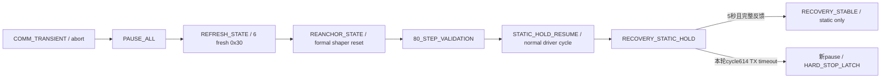

# J14-A1.5 Safe Re-anchor & Servo Resume Qualification

2026-10-08，main，HEAD `feba8fd00c392ecaab93b53138db7c1d06bce000`。

**A1.5 Software PASS；Hardware FAIL。** 唯一一次R1实际经历communication timeout、6/6 pause、6/6 fresh state、shaper/driver re-anchor及第一笔完整静态resume。随后STATIC HOLD在cycle614/ID1再次TX timeout，立即新一轮pause并hard STOP，未完成要求的约5秒静态资格。没有第二次recovery或run，没有硬件失败后的production修改。

| 阶段 | 实机结果 |
|---|---|
| PAUSE / REFRESH_STATE | PASS，本轮6/6 |
| REANCHOR STATE / SHAPER SYNC | PASS，本轮真实control确认 |
| 80-STEP VALIDATION | PASS，六轴first delta=0 |
| FIRST RESUME WRITE / FEEDBACK | PASS，cycle608完整六轴 |
| STATIC HOLD 约5秒 | **FAIL，cycle614/ID1 TX timeout** |
| LADRC / Classical ACTIVE performance | NOT EXERCISED |
| A1-TRANSPORT | PARTIAL / NOT YET QUALIFIED |
| A1-RUNTIME | NOT PASS |

## 1. 先只读的state audit：必须重锚、重置、保留与无关项

依据实际driver、transport、JointTrajectoryController/StatefulJerkLimitedShaper、IK/FK、J13 runner和PID/LESO实现读取后分类；没有仅凭变量名推断。[机读审计](/home/lyapunov/bone_drill/results/j14/j14_a1_5_software/reanchor_state_audit.json)。

| 分类 | 状态 | 根据代码的处理 |
|---|---|
| MUST REANCHOR | driver last-command、fresh feedback cache、static servo reference | last-command改为fresh measured；position/current/fault/rx_done复制本轮新状态；静态reference取正常shaper产生的first command |
| MUST REANCHOR | control current/target、shaper position q | `(raw-HOME)/steps_per_meter`映射joint displacement；正式controller.reset同步q/current/target |
| MUST RESET | driver latest target、old command debt、target stream continuity | 清空单槽；旧Cart/command不继续积累；复用现有re-anchor的write/ingress时间与stream-timeout语义 |
| MUST RESET | shaper dq/ddq/dddq、control dt origin | 正式reset_state定义零导数；_last_time重设ROS当前时刻 |
| MUST REANCHOR | transport recovery flags与new epoch | 许可仅固定static reference；新cycle从失败cycle+1完整ID1→6开始，第一笔反馈确认后解除delivery uncertainty |
| MUST PRESERVE | failed partial audit、旧TX/RX历史、cycle计数、watchdog旧时间 | history不是可继续batch；不清除旧1000ms watchdog gap；正常feedback ingest完成后才更新其有效采样 |
| MUST PRESERVE | shaper gain/饱和、HOME、steps_per_meter、geometry、安全阈值 | 不修改算法或参数，不改变坐标零位 |
| MUST PRESERVE | IK.reference_pose | 固定nominal geometric reference；不是上一段trajectory。没有重写Cartesian原点 |
| MUST PRESERVE | FK synchronizer history、last successful pose | FK反馈输出无本轮motion command权；不清空 |
| NOT RELEVANT | IK上一目标缓存/轨迹积分 | inspected IK node不存在这种历史状态；每个pose callback重新计算IK/deltas |
| NOT RELEVANT / MUST PRESERVE | J13 Classical integral、last_error、filtered derivative等 | 属于未启动的runner，不参与本轮static pipeline；不调用PID reset |
| NOT RELEVANT / MUST PRESERVE | LADRC z1/z2/previous_u_actual、IMU reference/u_plant_actual | 属于未启动的runner；不清零LESO、不验证ACTIVE restart |

生产Pus6ControlNode实际构建的是JointTrajectoryController与零correction的OuterLoopControllerHook，不含Classical PID或LESO。其正式reset(initial_positions)调用shaper.reset_state；后者置q为测量位置、dq/ddq/dddq为零。当前target=q时，原微分方程jerk项为零，正常update维持同一reference，不追赶旧轨迹。没有修改该算法文件。

Cartesian保持策略：本阶段没有活跃pose/attitude runner，不伪造新Cartesian command或重定义IK参考原点。fresh joint measurement通过现有正式Control/Shaper状态同步，随后正常control update与原meter→raw-step映射生成恢复目标；这不是恢复脚本直接裸写电机。未来Cartesian reference/LESO restart必须另行分析，本轮不提供ACTIVE许可。

## 2. 实现与production路径

状态链：

复用A1.4恢复专用read-only acquisition，确认完整健康新状态后调用已有driver re-anchor接口。driver清空old latest target并改last-command；control的原re-anchor handler使用正式reset。A1.5确认ACK在下一次**正常_control_loop**完成controller.update、原command topic publication与raw-step映射之后发送，携带本epoch的实际shaped first target。

原Int64MultiArray handshake的7元素ACK在普通/A1.3路径保持。仅A1.5 opt-in路径为 `[epoch, six fresh raw steps, six first shaped raw targets]`（13元素）；没有改变topic名称、type、QoS或Executor。driver仅接受匹配本epoch及fresh vector的ACK。之后逐轴计算first_target-fresh，使用原reconnect_max_jump_steps=80；任一>80即reject且无resume。原20-step driver preflight/slew仍保留；80-step admission并非绕过其他原约束。

恢复manager本身不发送一笔特殊0x29 hold；它只授权正常driver下一cycle。正常driver safety preflight→send_cycle→normal RX/drain→feedback ingest生成第一笔及后续静态transaction。transport要求固定reference和连续new cycle_id，禁止旧cursor、旧trajectory、verify_recovery_hold及普通ACTIVE release。成功稳定也不自动切换ACTIVE。

第一TX仍检查失败前feedback/scheduler epoch定义的原1000ms deadline，避免ACK后的调度延迟越界。不增加硬件安全阈值，不把小tracking error转为STOP gate。后续缺一轴的普通采样记录为资格信息，原watchdog继续负责motion safety；第一笔完整resume则必须六轴新反馈确认。

开始新的motion epoch前重新arm既有StopAdapter：恢复前pause不能保证后续写入后的停止。第一/后续静态write故障都会发一次新的六轴pause；本阶段绝不进行第二次recover。shutdown复用最后的pause audit。

| 本阶段增改文件 | 内容 |
|---|---|
| [communication_recovery.py](/home/lyapunov/bone_drill/bone_ws/src/pus6_motor_driver/pus6_motor_driver/communication_recovery.py) | static opt-in、同步确认、80-step、第一/后续事务审计、阶段结果分离 |
| [j7_six_axis_servo_transport.py](/home/lyapunov/bone_drill/bone_ws/src/pus6_motor_driver/pus6_motor_driver/j7_six_axis_servo_transport.py) | 限定固定static vector/new cycle、first deadline、第一完整反馈确认；不改UART/drain |
| [motor_driver_node.py](/home/lyapunov/bone_drill/bone_ws/src/pus6_motor_driver/pus6_motor_driver/motor_driver_node.py) | epoch ACK、旧command audit、静态target保持、正常cycle复用、再次timeout直接STOP |
| [control_node.py](/home/lyapunov/bone_drill/bone_ws/src/pus6_control/pus6_control/control_node.py) | 正式reset与同步审计，正常shaper周期返回ACK，静态期间丢弃旧desired deltas |
| [test_j14_a1_5_static_resume.py](/home/lyapunov/bone_drill/bone_ws/src/pus6_motor_driver/test/test_j14_a1_5_static_resume.py) | 16个新software cases |
| [j14_a1_5_static_resume.py](/home/lyapunov/bone_drill/bone_ws/scripts/j14_a1_5_static_resume.py) | 一次R1，30秒上限，约5秒static或首次失败结束 |

harness仅对本次子进程选择 `PUS6_J14_RECOVERY_STAGE=static_resume` 及专用audit目录。当前sourced install已确认指向本working tree源码。普通launch保留此前A1.3默认路径，本轮不能认证它的完整恢复或ACTIVE能力。

## 3. 软件验证

最终源码 **638 pytest PASS，44.22 s**，覆盖pus6_motor_driver、pus6_control、h30_imu，含J7/J11/J13/J14 regressions。新16cases覆盖6轴fresh→anchor、旧target差异、正式shaper导数归零、80允许/81拒绝、fresh缺失/fault/1501mA禁止重锚、missing ACK、new full transaction/no partial replay、第一feedback 5/6拒绝、deadline前后禁写、多个constant cycles与无ACTIVE，以及实际ROS control/driver同步后FIRST_RESUME_WRITE、FIRST_RESUME_FEEDBACK、STATIC_HOLD故障的停止与新pause。

软件全部FakeBus/FakeSerial、ROS_DOMAIN_ID=179，**hardware_write_count=0**。py_compile、三包colcon build、install源码路径、git diff --check PASS。TX30ms、serial RX5ms、普通request10ms、normal drain4ms、80step、283.3ms warning、1000ms hard stop、1500mA保持。adapter/protocol/UART基础文件与其他既有tracked edits未修改；JointTrajectoryController/StatefulJerkLimitedShaper、LADRC/Classical算法、QoS/Executor未修改。

证据：[pytest final](/home/lyapunov/bone_drill/results/j14/j14_a1_5_software/pytest_full_final.log)、[pytest XML](/home/lyapunov/bone_drill/results/j14/j14_a1_5_software/pytest_full_final.xml)、[build](/home/lyapunov/bone_drill/results/j14/j14_a1_5_software/colcon_build_final.log)、[scope AST/diff](/home/lyapunov/bone_drill/results/j14/j14_a1_5_software/scope_audit.json)、[runtime source/frozen values](/home/lyapunov/bone_drill/results/j14/j14_a1_5_software/verification_before_hardware.json)。

## 4. Hardware R1：单次，失败即停

运行共 **14.167565544 s（含启动/cleanup）**。cycle_summary_full保存615项、sequence0–614；详细cycle_timing是300项retained ring、sequence315–614，不能将详细ring误作整个run。最长30秒未达到，因静态再次timeout提前结束。

| 事件 | 实测 |
|---|---|
| 首次自然timeout | cycle607 / ID5 |
| 首次serial wall / CPU | 40.507041 / 0.675685 ms |
| 首次wrapper wall / configured TX timeout | 41.150189 / 30 ms |
| 原partial batch | ID1–4已发；ID5delivery uncertain；ID6未发 |
| pause completion epoch | 20303480563354 ns，六轴ACK |
| recovery handshake epoch | 20303462875098 ns，独立于pause freshness barrier |
| reanchor确认 | 20303620501498 ns |
| first resume | cycle608，六轴完整new transaction |
| first resume确认 | 20303629442650 ns |
| 后续完整static | cycles608–613，共6笔 |
| 再次timeout | cycle614 / ID1 |
| 再次serial wall / CPU | 41.418927 / 0.776366 ms |
| 再次wrapper wall | 42.070644 ms |
| 再次partial batch | ID1delivery uncertain；ID2–6未发送 |
| 最终故障阶段 | STATIC_HOLD，communication_static_resume_failed |

pause后的六轴新0x30反馈全部health validation通过；没有复用pause ACK或旧cache。fresh acquisition如下：

| ID | fresh RX done ns | fresh step | current mA | fault |
|---:|---:|---:|---:|---:|
| 1 | 20303485226744 | 1000 | 0 | 0 |
| 2 | 20303488816786 | 999 | 0 | 0 |
| 3 | 20303492221891 | 1000 | 0 | 0 |
| 4 | 20303495484586 | 999 | 0 | 0 |
| 5 | 20303517077870 | 1000 | 0 | 0 |
| 6 | 20303602093923 | 1000 | 0 | 0 |

ID5/ID6 query分别在TX后20.820973/83.818509ms取得匹配状态，final_collection=true、completed_after_wait_deadline=true；没有query retry或未决transaction error，仍在既有hard deadline内。它们是等待/完成区间，不是单次serial.read wall。既有RX与scheduler long-tail不在此阶段修复。

## 5. 真实re-anchor、first target与反馈

old command为六轴1000；canonical fresh为 `[1000,999,1000,999,1000,1000]`。driver的old latest target已持久化并清空。shaper旧target为六轴0 m、旧运动state接近0；本轮并非真实非零速度trajectory恢复实验，软件测试才覆盖显著旧velocity/acceleration的清除。

正式shaper sync start/done：20303603708071 / 20303603743745 ns。新relative position `[0,-0.000025,0,-0.000025,0,0] m`，dq/ddq/dddq全为0。下一个正常control周期在20303618446675ns生成同一raw target；driver匹配ACK后才授权normal servo。

| ID | old command | fresh / reanchor | first target | delta | ≤80 | first measured | current/fault |
|---:|---:|---:|---:|---:|---|---:|---|
| 1 | 1000 | 1000 | 1000 | 0 | PASS | 1000 | 0/0 |
| 2 | 1000 | 999 | 999 | 0 | PASS | 998 | 0/0 |
| 3 | 1000 | 1000 | 1000 | 0 | PASS | 1000 | 0/0 |
| 4 | 1000 | 999 | 999 | 0 | PASS | 999 | 0/0 |
| 5 | 1000 | 1000 | 1000 | 0 | PASS | 1000 | 0/0 |
| 6 | 1000 | 1000 | 1000 | 0 | PASS | 1000 | 0/0 |

第一笔ID2 feedback比target低1step，是诊断tracking error，没有新STOP gate。收到的fresh、first六轴、6次完整static和最终pause状态均current=0mA/fault=0；失败cycle614本身没有完成feedback scan，不能给该不确定写的瞬间状态补值。

first resumed TX（每轴10bytes、零retry、正常write-only0x29）：

| ID | TX start ns | TX done ns | serial wall ms |
|---:|---:|---:|---:|
| 1 | 20303622451191 | 20303622554055 | 0.061290 |
| 2 | 20303623164724 | 20303623238528 | 0.039213 |
| 3 | 20303623847955 | 20303623900847 | 0.020833 |
| 4 | 20303624510318 | 20303624573539 | 0.028210 |
| 5 | 20303625181612 | 20303625250108 | 0.039954 |
| 6 | 20303625856906 | 20303625900039 | 0.015411 |

第一cycle start/end为20303622435392 / 20303628761149ns，transport约6.325757ms、反馈6/6。全部TX在新pause/fresh/re-anchor epoch之后，从ID1重新开始，并未继续原ID6或重发原ID5失败frame。first反馈sample时间来自正常scheduler ingest的host边界，六轴可以相同，不是device timestamp或六轴同步保证。

## 6. Static duration及准确失败层

事件字段static_hold_duration为 **183.222508 ms**，从first resume确认算到失败记录，包含cycle614的failed TX以及随后pause处理。

first resume确认至cycle613最后完整feedback为 **99.851665 ms**。六笔完整static transaction的target完全一致，36个有效feedback current/fault均0/0、无缺失；但没有达到约5秒，更没有RECOVERY_STABLE。

cycle614只尝试ID1，该serial.write在30ms配置下41.418927ms报SerialTimeoutException；CPU0.776366ms。out_waiting0→0、in_waiting0→20，20bytes未被当作该motion transaction的已确认feedback；这不证明delivery成功或失败，仍按uncertain处理。ID2–6没有写入，不做第二次recovery，不解释为controller/shaper性能失败。

Cycle CPU/CS是entry-to-entry，不能代替failed write区间；底层TX long-tail机制仍UNKNOWN。该run另有早期cycle13的458.853ms inter-gap、445.786ms wake lateness，以及cycle79的10.170435ms read wall。这些信息保留，不进行scheduler/GIL/RX修改或额外实验。

## 7. Pause、cleanup和Git

本轮pause audit两个epoch：①首次timeout后的communication_transient；②静态再次timeout后的communication_static_resume_failed。两轮均六轴ACK、current0/fault0。第二轮ACK完成20303812259268ns，随后hard-stop checkpoint20303812666907ns。第二轮不是重试旧pause或旧motion，而是新motion epoch失败后的新停止保证；shutdown没有第三轮write。

Cleanup核查：无残留进程，ttyUSB0/ttyACM0/ttyACM1均释放；historical run pointers恢复。一次SIGINT给launch，无TERM/KILL升级。仍有既有rcl_shutdown already called异常，不能用launch exit0宣称干净退出；此问题未修。最终只读cleanup核查的hardware_write_count=0只描述该观察，不描述R1的实机写入。

Git保持main/HEAD及所有既有J14工作；tracked modified仍10项，本阶段仅增改其中transport、driver、control及原untracked recovery module；新增测试/harness/报告/数据。无reset/checkout/staging/commit/push/tag。硬件失败后仅分析与报告，无production修补或再运行。

## 8. 证据入口与最终verdict

| 证据 | 路径 |
|---|---|
| recovery events（reanchor/resume分别记录） | [recovery events（reanchor/resume分别记录）](/home/lyapunov/bone_drill/results/j14/j14_a1_5_r1_static_resume/communication_recovery_events.jsonl) |
| fresh raw UART/parser/timestamps | [fresh raw UART/parser/timestamps](/home/lyapunov/bone_drill/results/j14/j14_a1_5_r1_static_resume/fresh_state_acquisition.jsonl) |
| shaper正式reset与normal first output | [shaper正式reset与normal first output](/home/lyapunov/bone_drill/results/j14/j14_a1_5_r1_static_resume/shaper_reanchor_audit.jsonl) |
| driver旧command清理与ACK | [driver旧command清理与ACK](/home/lyapunov/bone_drill/results/j14/j14_a1_5_r1_static_resume/driver_reanchor_audit.jsonl) |
| first及后续static TX/feedback | [first及后续static TX/feedback](/home/lyapunov/bone_drill/results/j14/j14_a1_5_r1_static_resume/communication_static_cycles.jsonl) |
| 两轮pause ACK | [两轮pause ACK](/home/lyapunov/bone_drill/results/j14/j14_a1_5_r1_static_resume/stop_pause_audit.jsonl) |
| fault snapshot | [fault snapshot](/home/lyapunov/bone_drill/results/j14/j14_a1_5_r1_static_resume/fault_snapshot.json) |
| robot/launcher log | [robot/launcher log](/home/lyapunov/bone_drill/results/j14/j14_a1_5_r1_static_resume/robot.log) |
| run metadata | [run metadata](/home/lyapunov/bone_drill/results/j14/j14_a1_5_r1_static_resume/run_metadata.json) |
| 离线六轴CSV | [离线六轴CSV](/home/lyapunov/bone_drill/results/j14/j14_a1_5_analysis/six_axis_reanchor_and_first_resume.csv) |
| monotonic timeline | [monotonic timeline](/home/lyapunov/bone_drill/results/j14/j14_a1_5_analysis/monotonic_timeline.csv) |
| analysis | [analysis](/home/lyapunov/bone_drill/results/j14/j14_a1_5_analysis/analysis.json) |
| cleanup只读核查 | [cleanup只读核查](/home/lyapunov/bone_drill/results/j14/j14_a1_5_analysis/final_cleanup_check.json) |
| Git final | [Git final](/home/lyapunov/bone_drill/results/j14/j14_a1_5_software/git_status_final.txt) |

**A1.5 Software PASS；Hardware FAIL。** 本轮真实确认safe re-anchor和first static resume能力，但未取得稳定静态communication资格。A1-TRANSPORT仍PARTIAL / NOT YET QUALIFIED，A1-RUNTIME仍NOT PASS。未进入LADRC demo、人工扰动或下一阶段。J14-A1.5已停止。
