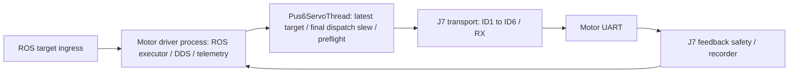
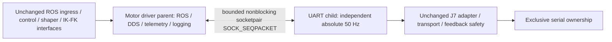

# J14-A1.9 pre-implementation architecture audit

Status: design issued before implementation; hardware not yet run.

Facts from current working tree: the dedicated worker owns adapter, transport and feedback scheduler; async telemetry publishes ROS messages in another thread of the same process. J7 adapter is injected, not a serial factory. Transport and feedback modules are ROS independent. Existing main uses three executor workers. Installed package uses symlink-install. Python subprocess/socket are already available; no dependency installation is needed.

Implementation choice: one local AF_UNIX socketpair with SOCK_SEQPACKET, nonblocking endpoints and finite buffers. Popen starts a clean Python module via pass_fds (no forked ROS runtime). Child imports no rclpy, ROS messages or DDS. An opt-in A1.9 subclass is selected only by the existing entry-point main; default class and frozen transport/protocol remain unchanged.

Parent keeps a single latest whole-vector outbox; its IPC worker sends updates and 100 ms lease messages, never a servo tick. Child drains the finite socket backlog before each independent cycle and admits only the newest complete epoch/sequence vector. Packets carry mode/permission, command monotonic time and separate lease time. No partial vectors, replay, trajectory FIFO or blocking IPC. Feedback can coalesce/drop under backpressure; fault safety never depends on sending feedback. EOF/child exit causes parent STOP; parent EOF or an expired existing 1000 ms lease causes child local pause, close and exit.

Child retains the original driver final dispatch slew (200 steps/s, minimum 5 and cap 20 per dispatch), range/fault preflight, existing 283.3 ms warning hold, 1000 ms hard stop and 1500 mA validator. Upstream controller/shaper stay in their original processes. Stream reconnect rejection remains 80 steps. No recovery resume is admitted after a transport fault, so full A1.4/A1.5 recovery is deliberately outside this trial. Serial TX 30 ms, RX 5 ms, drain 4 ms, baud 921600, IDs/order, inter-frame waits and RX policy are unchanged. Timeout aborts the batch and immediately invokes the existing six-axis one-shot pause in the child before persistence/IPC. Shutdown orders pause -> serial close -> child exit -> parent exit. A hard-killed child cannot itself pause; parent marks FAULT and never claims pause ACKs in that case.

Recorder stays beside UART for original strict write/RX metrics; parent retains presentation/logging and records IPC receipt/parent CPU samples. No normal per-cycle file IO: retained rows are flushed after motion stops. Parent CPU is sampled by the parent IPC worker with monotonic brackets. These samples are not substituted for exact child serial-write CPU; fault-time parent CPU is reported only with its actual surrounding interval. IPC age is diagnostic, with no new performance STOP gate.

A/B reference: keep the A1.8 diagnostics-deferral flag enabled in parent; only the UART process boundary changes relative to A1.8. Child necessarily replaces ROS snapshot construction with minimal IPC data; parent reconstructs existing ROS telemetry. Report this boundary bookkeeping difference and mock overhead explicitly. Compare frozen A1.7 and A1.8 hardware evidence without rerunning either baseline.

Validation plan: mock A-M coverage, actual subprocess/EOF/lease/backpressure/shutdown checks, ROS parent integration check, same-core thread/process CPU-load mock benchmark, build/syntax/diff checks. No mock test opens physical serial (hardware_write_count=0). Only after software PASS: R1 static <=30 s; first natural timeout/fault stops locally and ends run. R2 <=60 s only after a full clean R1, no timeout/fault, verified six-axis pause, serial close/process exit and evidence completeness. No ACTIVE LADRC, disturbance, scheduler/USB/OS changes, further productionization or Git commit/push/tag.

Implementation addendum before hardware: the clean child bootstrap loads the existing geometry_config leaf without the kinematics package's eager ROS-message imports. Actual subprocess tests confirm ROS-free modules. The original default driver class has identical AST to the pre-A1.9 snapshot; main selects only the opt-in subclass. Only the opt-in exit checks rclpy.ok before shutdown to satisfy deterministic cleanup after launch SIGINT; the historical default exit is preserved. Parent forwards the child's measured initial vector as one static reference (no new target), then whole ROS references with a separate sequence. Child enforces the experiment window independently. If receive reaches its bounded work cap, the 50 Hz cycle still holds the last safe vector and defers admitting a new vector until the backlog is drained. All strict write scalar metrics are retained for the full trial, in addition to the unchanged legacy 300-cycle ring. Final pre-hardware tests/build/source-path/resource checks passed.
