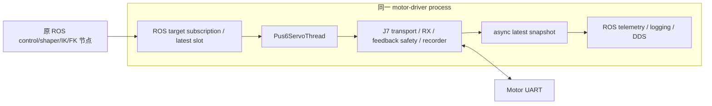
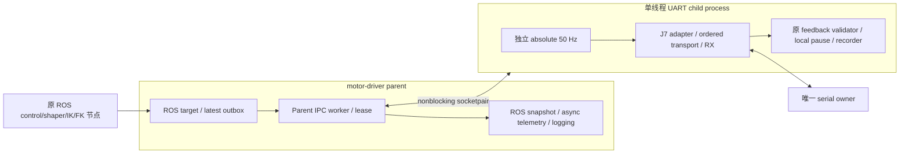

# J14-A1.9 Servo UART Separate-Process Minimal A/B

已完成并停止。**软件 PASS；独立 UART 进程的 30 s + 60 s STATIC SERVO 短时硬件验证 PASS。完整运行时 NOT PASS。**

Separate-process architecture has strong short-run hardware evidence. Process-local contention: **STRONGLY SUPPORTED CONTRIBUTOR**；GIL: **UNKNOWN**；USB/tty/kernel 尚未完全排除。没有证明唯一根因或可靠故障概率。两个独立短窗口不等于连续 90 s qualification。

设计先行证据：[设计审计](/home/lyapunov/bone_drill/docs/J14_A1_9_DESIGN_AUDIT.md)。全部表格来源为 [机读比较](/home/lyapunov/bone_drill/results/j14/j14_a1_9_software/a1_7_a1_8_a1_9_comparison.json)，分位数使用 inclusive linear interpolation；单位另有注明。

**1. 原 process architecture**

A1.8 只延后 driver_diagnostics 通道；UART worker 和其余 ROS/DDS 工作仍共进程。

**2. Separate-process architecture**

父进程从未打开串口；父 IPC worker 没有发 20 ms tick。原 controller/shaper 和 IK/FK 接口继续存在。Child 只执行最后的 driver dispatch slew / transport safety，未执行 ROS、DDS、LADRC、IK/FK 运算或消息构造。

**3. Serial ownership**

R1 child PID 576697、parent PID 576629；R2 child PID 579301、parent PID 579234。运行时 fuser 都只返回 child PID；child 各有 1 个 OS task，parent 快照分别有 16/15 个 task，包含 DDS native tasks。clean child bootstrap 绕过 kinematics 包的 eager message imports，仅加载其原 geometry_config 数据模块；实际子进程的 `modules_without_ros=true`。记录在两轮 `runtime_process_boundary.json` 和 `child_ready.jsonl`。

**4. IPC 机制**

只选 AF_UNIX socketpair / SOCK_SEQPACKET；两个 endpoint nonblocking，有限 socket buffers、16 KiB packet 上限、每次最多 64 包接收。完整 vector 原子 packet，不使用共享内存、队列线程或 ROS IPC。Popen + pass_fds 启动 clean interpreter，没有 forked executor/DDS。发送满时立即返回；fault 本地处理优先于 IPC。

**5. Command latest semantics**

Parent 单槽覆盖未发送目标。Child bounded-drain 后只接受最新完整 epoch/seq；附原 command monotonic timestamp、独立 lease timestamp、static mode 和 allowed state。若工作上限用尽而尚有 backlog，该 cycle 仍按 50 Hz hold 最近安全 vector，下一次 drain 完成后才 admit 最新 vector；不执行排队 trajectory。startup reference 等于 child 刚测得的位置，没有另加 Cartesian motion。ROS reference 使用独立递增 seq。旧 epoch、partial/noninteger vector、错误许可和 replay 拒绝。200 ms stream reconnect 的 80/81-step 边界保留。

**6. Feedback IPC semantics**

Packet 返回六轴 position/current/fault/rx_ns、cycle_seq、command_seq、target、每轴 TX 时戳和耗时、RX drain、freshness、scheduler gap、communication fault、feedback-ready timestamp。Parent 加 receive timestamp 并重建既有 JointState/TimedFeedback/TimedCommand/raw topics；QoS 未改变。反馈可以在有限背压下丢弃；父端接收审计有 R1 1398 / R2 2775 个 cycle，而 child 完成 1500/2999，差值为 102/224。不能把差值解释为 UART 丢帧或 ROS 最终消息丢失的精确计数：drop/EOF 细分和每次 ROS publication timestamp **NOT RECORDED**。

**7. Local safety semantics**

复用原 adapter、transport、feedback scheduler、six-axis one-shot StopAdapter。TX=.030 s、RX=.005 s、drain=.004 s、baud=921600、ID1→6、discard-before-TX、adapter .0001 s / transport .0006 s inter-frame behavior 原样保留；warning .2833 s hold、hard stop 1 s、1500 mA validator、raw/normal range、20-step final cap 和 driver vector slew 保留。TX timeout 后 batch abort，Child 立即 pause，随后才保存故障/发 IPC；没有 motion retry 或完整 recovery/resume。两轮无自然 timeout，**真机 timeout-local-pause 路径尚未实际触发**；硬件确认的是结束窗口的六轴 pause，软件覆盖故障路径。

**8. Parent death**

EOF 或超过现有 1000 ms lease 后 child 本地 pause、close、exit。100 ms lease 发包频率不是新的 motion STOP 阈值；command/feedback IPC age 不作为新 gate。Mock 覆盖实际 parent process kill、EOF 和保持连接但停止 lease。

**9. Child death**

Parent 通过 poll/EOF latch STOP/FAULT，health false，不再接受 motion reference。Mock 包含 child SIGKILL。被 SIGKILL 的 child 无法再发送 pause，父进程也没有 UART fallback；该场景没有伪造 ACK，尚不是生产级故障安全完整性证明。

**10. 修改文件**

A1.9 对原 tracked production 文件只增加 `motor_driver_node.py:main` 的 opt-in subclass 选择和 opt-in shutdown context 检查；默认 driver class AST 与进入阶段前完全一致。新模块：`j14_process_uart.py`、`j14_process_driver.py`、`j14_uart_child_main.py`；新软件测试 `test_j14_a1_9_process_uart.py`；新 scripts `j14_a1_9_capture.py`、`test_j14_a1_9_capture.py`、`j14_a1_9_mock_benchmark.py`、离线 `j14_a1_9_analyze.py`；本设计审计和最终报告。UART child 是实验模块；没有 productionize。A1.8 defer flag 在 parent 保持开启。边界替换的必要记账差异：child minimal IPC data 替代 ROS snapshot；parent 重新构造 snapshot；UART recorder 留在 child，presentation/logging 在 parent。

**11. Software tests**

相关 driver/control/kinematics 回归 **506 passed**（`pytest_final.txt`）；最终阶段专测 **25 passed**（`pytest_release_scope.txt`），R2 admission 单独复核 **2 passed**（含重叠用例；不是相加后的总数）。覆盖 A–M、ID1/3/6 timeout partial abort/本地 pause、actual serial factory .030/.005 参数、fault/1501 mA、80/81-step、epoch/replay/partial rejection、独立 50 Hz、背压、实际进程死亡、ROS parent 不打开 serial、pause→close→child exit→parent exit。三包 colcon build、py_compile、git diff --check PASS。**hardware_write_count=0**；所谓 active factory 测试实际 monkeypatch 到 protocol-aware FakeSerial，禁止打开 `/dev/DO_NOT_OPEN`。

**12. Mock A/B benchmark**

三组交替配对、每条件 2 s、每次 101 cycles；同一个 ServoCore/MockServoBus/50 Hz/inter-frame 等设置，parent 两个 Python load threads（各 busy 1 ms / sleep 4 ms）。Same-process wake P99 为 2.039465/1.938899/2.227046 ms，separate-process 为 .269284/.298134/.305243 ms。Child/thread cycle CPU P50 约 3.4–3.8 ms；独立进程 process CPU 接近其 thread CPU。原始逐周期 CPU/CS/jitter 和 parent CPU 均在 `benchmark_frozen_*` 及 `mock_ab_benchmark_frozen.json`。此前 prototype benchmark 文件保留但不作为最终结论依据。无 ROS executor synthetic load；Mock 不证明物理 UART 或硬件 PASS。

**13. R1 结果**

只跑一次：配置 30 s，1500 cycles / 9000 successful writes，0 timeout / 0 hardware fault。stop decision 的实际 interval 30.000197657 s；最后 serial.write 在 29.983657702 s 完成，所有 TX 均在 30 s 内。launch→stop 30.936913 s，含启动/清理总计 31.332592 s。6/6 pause ACK，serial close 和 child exit 已记录。

**14. R2 结果与 admission**

只跑一次：配置 60 s，2999 cycles / 17994 successful writes，0 timeout / 0 hardware fault。stop decision interval 60.000389832 s；最后 serial.write 在 59.984242630 s 完成，所有 TX 在 60 s 内。launch→stop 60.970466 s，总计 61.518075 s。原 absolute-deadline late-reset 行为未改；2999 不改写成 3000。

R1 metadata 原 `r2_admissible=false` 来自 harness 多加的“任何 ROS shutdown traceback 都阻断”条件。R1 既有 control/kinematics shutdown exception 出现在 UART pause/close 之后；6 ACK、child closed/exit 0、parent destroyed、无残留、三串口 free 均独立确认，满足用户规定的 full 30 s/no timeout/no hardware fault/complete cleanup。随后仅修正 **harness 非硬件准入解释**，保留 original metadata 和 [admission audit](/home/lyapunov/bone_drill/results/j14/j14_a1_9_r1_static_separate_process/r2_admission_audit.json)，通过两项软件准入测试后进入 R2。没有在 R1 后改变 production、UART、安全阈值或调度设置。异常仍影响完整运行时 qualification，未被删除或当作无异常退出。

**15. Timeout count**

A1.7=1，A1.8=1；A1.9-R1=0，R2=0。两轮 4499 cycles / 26994 TX，全量 strict write scalar records 保留；不从这几个独立短样本计算可靠故障概率。

**16. First failure time**

A1.7 first cycle→failed serial exit 6.890238343 s（cycle278/ID6）；A1.8 1.659291071 s（cycle52/ID1）。A1.9 两轮没有 first failure，分别在 30/60 s 截止右删失；first-failure timestamp 和 fault-time parent CPU 均不适用。

**17. Write timing**

全部 successful serial writes；单位 ms；列为 P50 / P95 / P99 / Max。Failed writes 单列，不混入成功分布。

| Condition | N | serial wall P50/P95/P99/Max | failed serial wall |
|---|---:|---|---:|
| A1.7 | 1673 | 0.029463 / 0.267440 / 0.934707 / 18.525765 | 61.809583 |
| A1.8 | 312 | 0.035218 / 1.018123 / 10.434091 / 19.004500 | 288.827530 |
| A1.9 R1 | 9000 | 0.030370 / 0.070427 / 0.090425 / 1.521826 | none |
| A1.9 R2 | 17994 | 0.029415 / 0.070007 / 0.087406 / 0.215552 | none |

R1 wrapper wall=0.065958 / 0.153523 / 0.200235 / 1.735902 ms；R2=0.062093 / 0.150480 / 0.194849 / 1.987369 ms。两轮所有 out_waiting_before=0；没有观察到此前 40–300 ms pathological TX。

**18. UART child CPU**

| Measure (ms; P50/P95/P99/Max) | R1 | R2 |
|---|---|---|
| strict serial thread CPU | 0.031154 / 0.071169 / 0.091128 / 0.161771 | 0.030241 / 0.071223 / 0.088953 / 0.215277 |
| paired serial child process CPU | 0.033476 / 0.075663 / 0.096443 / 0.171492 | 0.032321 / 0.075740 / 0.094685 / 0.220059 |
| cycle thread CPU | 6.756885 / 7.403847 / 7.894914 / 23.753395 | 6.719133 / 7.340464 / 7.839826 / 40.549328 |
| cycle process CPU | 6.756314 / 7.400465 / 7.892972 / 23.751163 | 6.718324 / 7.338605 / 7.834480 / 40.549886 |

Strict wall/thread CPU 是原 adapter 的 serial call 边界；process CPU/CS pair 使用略宽 snapshot 区间，不能把几微秒差值当作 exact call CPU。Child cycle CPU 与 ROS parent 分开，测量区间含 write-metric 记账，略宽于 wall scalar 的取样时刻；各分布极值未必属于同一 write/cycle。Cycle CPU sum 10.118136 / 20.092236 s，不包含全部 child startup/idle/cleanup CPU，不能当作 whole child lifetime CPU。

**19. UART child context switches**

每 successful write voluntary CS：两轮 P50/P95/P99=0/0/0，Max=1/1；involuntary Max=1/2。Cycle voluntary P99=1/1、Max=1/1；involuntary P99=3/2、Max=7/7。相比 A1.7/A1.8 failed-write voluntary CS 156/867，未出现对应异常。不同区间/成功分布与失败样本分开比较。

**20. Parent CPU**

父 process CPU 在 IPC worker 中累计采样：R1 在 30.243592254 s sample span 内增加 14.510412933 s；R2 在 60.091110333 s span 内增加 30.725057530 s。父进程工作仍显著存在，而 child write CPU/CS 不再带其争用特征。没有 timeout，所以无需故障 bracket；若出现故障，只能取真实相邻 parent samples 的较宽 bracket，不能冒充 serial call 精确区间。没有 strace/perf 或调度配置修改。

**21. IPC latency**

单位 ms，P50/P95/P99/Max。Command age 按父端实际收到反馈的 distinct command_seq 计算（997/1878 个），是可观测子集，不是全部 target ingress latency；反馈 IPC age 按已收到 packet 计算（1398/2775 个），丢弃 packet 无 latency 值。

| Measure | R1 | R2 |
|---|---|---|
| publish→child receive command age | 2.473506 / 10.680482 / 15.982604 / 41.625088 | 8.265292 / 9.419012 / 20.225510 / 367.690091 |
| child-ready→parent-receive feedback age | 0.594746 / 187.209758 / 366.893107 / 486.072352 | 0.502583 / 165.015254 / 430.385725 / 792.706246 |
| parent observed feedback gap | 19.862093 / 43.386426 / 202.297046 / 506.467128 | 19.966273 / 44.047398 / 181.786969 / 811.690260 |

这保留了父侧阻塞/有限 IPC backlog 的真实代价；最大 age .486/.793 s 不是 child RX feedback stale。不能把 child UART 稳定直接等同于 ROS effective control rate 改善。未新加 IPC-age STOP gate。

**22. RX / scheduler / heartbeat**

全量 cycle-summary 的 RX drain P99/Max：R1 2.954010/3.096 ms；R2 2.929020/3.087 ms。单次 read 的逐 cycle maximum 取 Max：.119266/.119176 ms（不是所有 read 的分位数）；read calls 3146/6335、bytes 180000/359880。`rx_read_events.csv` 无 selected slow/representative rows，但 full summary 有每周期 read maxima；因此不把空表解释成没有 read。Child feedback_age_max Max=40.7/39.7 ms，warning records 为空。

Child wake P99/Max：.304759/4.160436 ms 与 .267446/3.599479 ms；cycle interval median=20.000214/20.000340 ms，Max=23.899595/40.273715 ms。R2 cycle2190 的约 40.10 ms wall 与约 40.55 ms CPU/0 voluntary CS 是 child 自身 compute/bookkeeping 长 cycle，不是 serial.write timeout；其具体 compute leaf **UNKNOWN**。不修第二件事。两个外部 heartbeat 都无 >20 ms 记录；该 observer 在独立 harness process，不能证明所有 host delay 为零。

**23. A1.7 / A1.8 / A1.9 比较**

所有保存的 J13 config YAML byte-identical，geometry source 未改。A1.9 保留 A1.8 diagnostics deferral，唯一实验变量为 UART execution process boundary；必要 IPC/snapshot 记账差异已披露。

| Condition | Cycles (含失败 cycle) | First failure / censor | Write P99 ms | Read max ms | Wake max ms |
|---|---:|---|---:|---:|---:|
| A1.7 | 279 | 6.890238 s / cycle278 ID6 | .934707 | 205.453154 | 419.799 |
| A1.8 | 53 | 1.659291 s / cycle52 ID1 | 10.434091 | 69.196555 | 141.345 |
| A1.9 R1 | 1500 | no failure, 30 s censored | .090425 | .119266 | 4.160436 |
| A1.9 R2 | 2999 | no failure, 60 s censored | .087406 | .119176 | 3.599479 |

两轮 child cycle wall P99 为 7.867527/7.820392 ms，父侧 feedback gap/age 长尾仍在。A1.7/A1.8 的 callback 包括不同的 parent/ROS snapshot 路径，不能把表中差值归结为单项算法性能。基线未重跑；不把不同运行时长和样本量当可靠故障率。

**24. Process-local contention verdict**

**STRONGLY SUPPORTED CONTRIBUTOR**。依据是 30/60 s 两轮无自然 TX timeout，严格 serial wall/child CPU/CS 明显收敛，UART owner 只有单线程 child，而重 CPU/多线程 ROS parent 和其 feedback 接收长尾继续存在。相对于此前同进程两轮故障，具有 strong short-run hardware evidence；未证明唯一根因，未给出长期 qualification 或精确因果占比。

**25. GIL verdict**

**UNKNOWN**。没有 GIL owner/wait tracing；单进程调度/资源竞争证据不能直接标为 GIL root cause。隔离也移走了 executor/native/DDS/logging 的共享执行域。

**26. USB / tty / kernel verdict**

**NOT EXCLUDED**，本轮未出现 pathological TX，因而没有新 fault-time kernel/USB capture；没有调整 USB、CH340、tty、kernel、affinity 或 priority。本轮不支持提高 USB 为首要方向，也不能证明它对所有旧故障无贡献。

**27. 唯一下一建议**

下一阶段先做 **parent feedback IPC consumption → ROS publication 长尾的归因审计**，把已存在的 ready/receive age 与尚缺的 publication 时戳对齐，UART child 不再同时改动。不要立即 productionize、跑 LADRC、扰动或扩展到 120/300/600 s。此建议尚未执行。

**28. A1-TRANSPORT verdict**

**SHORT-RUN HARDWARE PASS / NOT FULLY QUALIFIED**。限于 A1.9 independent-process static 30+60 s 的正常六轴 UART streaming 与窗口结束 pause/close。Natural timeout-local-pause 没有实机触发，完整 recovery 未迁移也未验证，不能升级为完整 production transport qualification。

**29. A1-RUNTIME verdict**

**NOT PASS**。Child UART domain 的短时改善成立，但 parent feedback IPC/ROS 链仍有长 gap；full effective control-rate/publication timing 尚未 qualification，且两个既有上层节点退出异常继续存在。Controller/LADRC ACTIVE 在本轮未执行，不能判其算法硬件失败或 PASS。

**30. Cleanup**

两轮各一次 six-axis pause，均 6/6 status ACK；审计持久化。child lifecycle 顺序 pause_complete→serial_closed→child_exit；parent lifecycle child_joined(exit0)→parent_node_destroyed。最终无相关残留 process，ttyUSB0/ttyACM0/ttyACM1 free；temporary result pointers 已恢复。motor-driver parent 和 child clean exit；control/kinematics 仍出现 `rcl_shutdown already called` / exit1，parent telemetry 在 context shutdown 后有 publication warning。未凭 launch returncode0 宣称所有 ROS nodes 干净退出；未修这些既有节点或追加运行。

**31. Git status 与停止**

branch `main`，HEAD `feba8fd00c392ecaab93b53138db7c1d06bce000`。原 10 个 tracked dirty files 和大量既有 untracked 工作保留；A1.9 tracked 增量仅 main opt-in wiring，完整新增文件纳入阶段 only diff。没有 reset/checkout/staging/commit/push/tag。保存 pre-A1.9 diff、only diff、final full diff/status 和 source preservation 验证。**STOP：硬件运行、productionize 和进一步修复均已停止。**

证据入口：[R1](/home/lyapunov/bone_drill/results/j14/j14_a1_9_r1_static_separate_process/run_metadata.json) · [R2](/home/lyapunov/bone_drill/results/j14/j14_a1_9_r2_static_separate_process/run_metadata.json) · [A1.9 only diff](/home/lyapunov/bone_drill/results/j14/j14_a1_9_software/a1_9_only.patch) · [Git status](/home/lyapunov/bone_drill/results/j14/j14_a1_9_software/git_status_final.txt)
