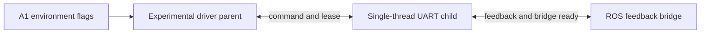

# J14-A2-P1 pre-implementation design audit

Issued before implementation. A1 debugging is CLOSED. Hardware not yet run in P1.

Current: motor_driver_node:main chooses experimental J14ProcessMotorDriverNode from PUS6_J14_SEPARATE_UART_PROCESS; FEEDBACK_BRIDGE and WINDOW_S are also environment choices. ProcessClient already owns both subprocesses, separate bounded command/feedback sockets, and CHILD_READY + BRIDGE_READY + parent start -> SERVO_START handshake. Adapter/transport/safety constants are unchanged. Bridge owns /joint_states, TimedFeedback and TimedCommand publication. Parent currently creates publishers then drops references; Node still retains them. Three-process parent's legacy freshness property also uses a cache populated only at startup. Production cannot rely on either behavior.

Target: the same three-process architecture, one normal driver launch, formally selected by ROS parameters. Add a small production entry/factory and parent subclass; retain the original legacy class and experimental modules. Normal main defaults to driver_architecture=three_process; explicit legacy_single_process selects the original class. Preserve old experimental entry as a separately named debug executable, not an environment-dependent normal production choice.

Use normal ROS parameter parsing with a short-lived parameter-only Node probe (no feedback publishers/UART); the real parent exposes effective parameters. A new driver-only defaults YAML precedes the user-selected system/J13 YAML; explicit nonempty launch arguments override YAML. Existing controller, geometry, J13 YAML and frozen transport files remain untouched. Driver lifecycle continues to create/join Child and Bridge; no separate manual launch steps.

Formal parameters: driver_architecture; enable_coordinated_handshake (required true in three_process); driver_telemetry_mode=production|qualification|debug; driver_audit_directory; servo_run_duration_s (0 means production runs until explicitly stopped; positive value bounds qualification); driver_telemetry_capacity_cycles. Frozen driver defaults: dedicated_thread, async_latest, age_based, reconnect80, freshness.2, 50Hz/921600. Child scheduling, frame bytes/order, RX/drain/interframe, warning.2833/hard1, TX.030, RX.005, drain.004 and validator1500 remain identical. No socket buffer changes.

Parent suppresses feedback/raw diagnostics publishers at creation, has no telemetry publication worker in production, never opens UART or consumes feedback socket. It keeps ROS ingress/latest command sequence/100ms lease delivery, endpoint/process health and startup coordination. Health uses process/command-channel fault state, not stale startup-only feedback cache. Child preserves local pause on fault, bridge socket death or parent lease/EOF. Bridge retains only feedback publication authority; it reports EOF/exception health and never acquires UART/command authority.

Telemetry: always retain bounded lifecycle/fault/pause records, recent cycle/TX/RX evidence, cumulative health counters and extrema, Bridge receive/drop/health summaries. Qualification retains up to configured capacity of cycle/write/bridge timing records for distributions; debug additionally preserves detailed pipeline phases. Normal path uses bounded in-memory retention and exit/fault flush. Existing low-level recorder/transport audit lists are bounded per production instance only; no change to frozen classes/default experiment behavior. Necessary packet JSON remains; do not optimize protocol, schedule or IPC. Remove experiment-only 60s ceiling only for production configuration, allowing later 120/300/600 qualification without running those windows now.

Validation: A-X production config/ownership/unique publisher/handshake/Cycle0/frozen parameters/latest/safety/death/shutdown tests in Mock; existing J7/J8/J13 and four-package regression pytest, py_compile, diff check and colcon build. Actual ROS graph must show exactly one Bridge publisher per feedback topic. Software hardware_write_count=0. After software PASS, one P1-R1 30s and eligible P1-R2 60s via normal launch arguments and YAML, with all PUS6_J14 flags removed from environment. Qualification capture selects duration/audit path/telemetry through ROS arguments only; watchlist ages/gaps/wake tails are diagnostic, not gates. Keep historical results/docs/scripts; classify scripts KEEP/ARCHIVE/LEGACY DEBUG, no deletion. Save pre-stage and P1-only diff; no commit/push/tag. STOP after report.
